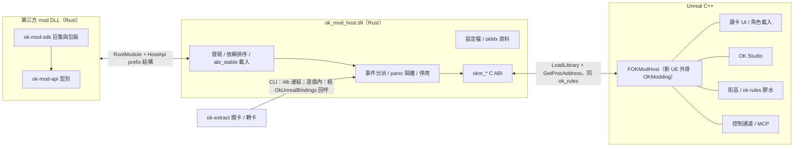
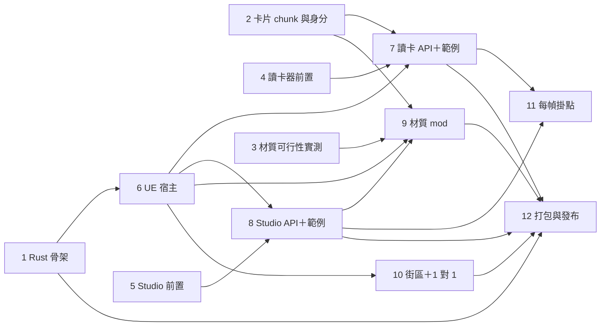

# OK Mod 框架計畫（2026-11-22）

目標：讓第三方用 **Rust DLL** 為 OpenKoikatsu 加功能，介面用 [`abi_stable`](https://docs.rs/abi_stable/latest/abi_stable/) 保證跨編譯器版本的二進位相容。參考對象是原作生態的三層：

- **BepInEx**（載入器）＋ **KKAPI / ExtendedSave**（給插件用的穩定 API）—— <https://github.com/IllusionMods/KK_Plugins> 裡的插件都建在這兩層上；
- **KK_Plugins**（一批具體功能插件：MaterialEditor、Pushup、InvisibleBody、HairAccessoryCustomizer…）；
- **HF_Patch**（<https://github.com/ManlyMarco/KK-HF_Patch>）：把載入器、API、插件、修正打成一個有版本、可選元件的安裝包。

本文件只是計畫，還沒有任何程式。

## 1. 原作生態對照到 OK

| 原作 | 作用 | OK 裡對應的東西 |
|---|---|---|
| BepInEx chainloader | 掃描 `BepInEx/plugins`，按 `[BepInDependency]` 排序載入 | `ok-mod-host`：掃描 `Mods/`，讀 `mod.toml`，依賴排序，`abi_stable` 載入 DLL |
| `[BepInPlugin(GUID, Name, Version)]`、`[BepInDependency]`、`[BepInIncompatibility]`、`[BepInProcess]` | 插件身份與依賴 | `mod.toml` 的 `id`／`version`／`dependencies`／`incompatible`／`targets` |
| BepInEx `ConfigFile`／`ConfigEntry` ＋ ConfigurationManager | 設定項與自動設定畫面 | Config API：註冊時宣告型別化設定項，宿主存檔並自動生成設定頁 |
| Harmony | 任意修補遊戲方法 | **不提供**。只有宣告好的掛點（見 §6.10） |
| ExtendedSave（`KKEx` 區段） | 插件資料存進卡片／服裝／場景，不認識的資料原樣保留 | 新 PNG chunk `okMx`（§6.2），另外可**唯讀**原作卡的 `KKEx` 區段 |
| KKAPI `CharaCustomFunctionController` | 每個角色一個插件控制器，收載入／存檔／換裝事件 | Character API：每角色一個 mod 控制器（§6.3） |
| KKAPI `MakerAPI`（`MakerSlider`／`MakerToggle`…、`MakerLoadToggle`） | 往捏人畫面加控制項、加「載入時要不要套用」開關 | Reader UI API：宣告控制項，宿主用現有讀卡 UMG 畫出來（§6.4） |
| KKAPI `StudioAPI`、`SceneCustomFunctionController` | Studio 面板、場景資料 | Studio API（§6.5） |
| KKAPI `GameAPI`、`GameCustomFunctionController` | 主遊戲存讀檔、日程事件 | Street API：掛到 `ok-rules` 的規則與事件（§6.6） |
| Sideloader zipmod | 資源（模型、貼圖）mod，玩家要另外裝 | **不對應到 mod**（2026-11-22 定案）：外觀資源一律在轉卡時打進 OK 卡（`okLc`），卡片自含；`.okmod` 只放新功能（程式）。mod 要往卡裡加東西走 §6.12 |
| HF_Patch | 打包安裝、可選元件、清舊檔、版本對齊 | `ok-mod-pack`：`.okmod` 打包／安裝／驗證，mod profile 鎖版本（§9） |

### 1.1 三個參考來源：借用什麼、不借用什麼

依據：2026-11-22 淺層 clone 四個倉庫後唯讀 grep。這四個倉庫是 BepisPlugins（ExtendedSave、Sideloader）、IllusionModdingAPI（KKAPI）、KK_Plugins、KK-HF_Patch，細節在 [OK_MOD_HOOK_INVENTORY.md](OK_MOD_HOOK_INVENTORY.md) §1。

**BepInEx（載入器）**

| 借用 | 到 OK 變成 |
|---|---|
| `[BepInPlugin]` 的 GUID／名稱／版本 | `mod.toml` 的 `id`／`name`／`version` |
| `[BepInDependency]` 的硬／軟依賴、`[BepInIncompatibility]` | `dependencies`／`optional_dependencies`／`incompatible` |
| `[BepInProcess]` 限定在哪個執行檔載入 | `targets`（reader／studio／pair／street／extract） |
| `ConfigFile`／`ConfigEntry`（含說明、數值範圍、`KeyboardShortcut` 熱鍵型別）＋ ConfigurationManager 自動設定畫面 | Config API：設定項帶說明 id、範圍、熱鍵型別，宿主自動生成設定頁 |
| chainloader 遇到壞插件就跳過並記錄；MessageCenter 把錯誤顯示在畫面上 | 宿主停用出錯的 mod，log＋畫面通知 |

不借用的：

- Harmony 與 preloader patcher：會改寫遊戲程式，OK 只開宣告好的掛點；
- ScriptEngine 執行期重新載入 dll：只保留開發模式的熱重載（§7.5）。

**KKAPI＋ExtendedSave（給插件用的穩定 API）**

| 借用 | 到 OK 變成 |
|---|---|
| `CharaCustomFunctionController`：每角色一個控制器，有 `OnCardBeingSaved`、`OnReload(maintainState)`、`OnCoordinateBeingSaved/Loaded` | Character API 控制器（§6.3），保留 maintainState 語意："這次載入沒勾選這個 mod 的資料時，沿用目前狀態" |
| MakerAPI 控制項：Button、Color、Dropdown、Image、RadioButtons、Separator、Slider、Text、Textbox、Toggle；分頁（MakerCategory）、側邊欄、飾品視窗逐槽控制項（`AccessoryControlWrapper`） | 讀卡 UI 宣告式控制項（§6.4）。種類照抄這 10 種，另加"逐飾品槽"控制項 |
| `MakerLoadToggle`／`GetCharacterLoadFlags`（載入卡時選要套哪些部分） | 宿主統一的"載入時套用哪些 mod 資料"開關 |
| StudioAPI：`CurrentStateCategory`（角色狀態面板）、`SceneEffectsCategory`（場景效果面板）、工具列按鈕、右鍵選單 | Studio API 的四個 UI 位置（§6.5） |
| `SceneCustomFunctionController`：`OnSceneLoad(Load／Import／Clear, 舊 id→新物件)`、`OnObjectsCopied`、`OnObjectDeleted`、`OnObjectsSelected` | Studio 場景控制器，事件照抄；匯入場景時給新舊物件 id 對照，mod 據此修正它存的物件引用 |
| `TimelineCompatibility`（插件的值可以上時間軸） | 時間軸 `Owner = "mod.<id>"` 的可插值屬性 |
| GameAPI：StartH／EndH、DayChange／PeriodChange、GameSave／GameLoad、NewGame；KKS 的 EventApi（ADV 劇本）、StoreApi（商店）、TopicApi（話題） | 街區事件（§6.6）；商店、話題、事件劇本改成"資料表擴充"，由規則和 AI 使用 |
| ExtendedSave `PluginData { version, data }`；不認識的資料原樣保留 | `okMx` 每個區段帶 `version`，宿主原樣保留別人的區段 |
| ExtendedSave 的範圍：卡、服裝、子物件（臉、身體、頭髮、衣服、飾品各部件）、場景、姿勢、遊戲存檔 | `okMx` 範圍：character／outfit／part（部件）／scene／pose／street_save |
| `CardBeingImported`（KK→KKS 轉換時改 id） | `on_upgrade(舊版本, 資料)`：mod 自己的資料格式升級 |
| `LoadEventsEnabled`（掃卡清單時不觸發載入事件） | 卡牆掃描與縮圖不叫 mod，只有真正載入角色才叫 |

不借用的：

- 直接拿 `ChaControl`／MonoBehaviour：mod 不碰 UObject；
- `SynchronizedInvoke` 之類的跨執行緒呼叫：宿主統一在 game thread 叫 mod，背景掛點另外標明；
- Sideloader 的 UniversalAutoResolver（GUID→槽位 id 重對）：OK 卡自含（§6.12），只有轉卡時用得到，留在核心。

**KK_Plugins（一批具體功能插件）**

- **借用功能清單**：範例插件從這裡挑（§14）。
- **不借用原始碼**：KK_Plugins 是 GPL-3.0，只參考行為與資料格式。
- 51 個插件裡有 39 個靠 Harmony 修補遊戲。到 OK 後，這些需求要嘛走宣告好的掛點，要嘛直接做進核心。下面這些已經是 OK 核心，不再做成 mod：MaterialEditor、Pushup、InvisibleBody、HairAccessoryCustomizer、UncensorSelector、EyeControl、Colliders、DynamicBoneEditor。

**HF_Patch（有版本、可選元件的安裝包）**

| 借用 | 到 OK 變成 |
|---|---|
| 安裝類型 full／extra／bare／custom | `ok-mod-pack profile`：官方提供 `starter`（入門）、`full`（全部範例），玩家可自訂 |
| 元件分類 API／FIX／Content／Feature／MISC | `mod.toml` 的 `category`：`feature`（功能）／`content`（看卡必需）／`tool`（工具）／`fix`（修正） |
| Content 類（不裝就讀不對卡） | 在 OK 大幅縮小：卡片自含，只剩"卡用到 B 層 shader"這一種（§6.12） |
| `[InstallDelete]` 已知過時或不相容的 DLL 清單；偵測"垃圾／不相容"插件並建議刪除 | `Mods/obsolete.toml`（核心維護，id＋版本範圍），安裝與 `verify` 時移到 `Mods/.old/` 並說明原因 |
| 同 GUID 的 zipmod 只留最新版（`RemoveSideloaderDuplicates`） | 同 id 的 mod 只留最新版 |
| 改動前備份、寫入版本戳記、安裝前關閉遊戲、檢查安裝路徑 | `install` 前備份到 `Mods/.old/`、寫 `Mods/.installed.toml`、用控制埠確認遊戲沒在跑、路徑檢查 |

不借用的：

- Inno Setup 安裝程式：改成 Rust CLI；
- 替遊戲本體打補丁：遊戲由 stage 發布，不由 mod 包修改；
- 一鍵清空整個插件資料夾：只移動有問題的 mod。

## 2. 硬性原則

1. **程式只能是 Rust cdylib**，經由 `ok-mod-api`（`abi_stable`）。不開放 Lua、C#、藍圖、原始 C ABI 給 mod 作者。**內容**另外可以帶 cook 好的材質 pak（§6.11），但 pak 裡不准有任何可執行內容（Blueprint 一律拒絕）。
2. **mod 不碰 UObject**。和 `ok-rules` 一樣：宿主把事實交給 mod，mod 回傳「要改什麼」，由宿主（UE C++）執行。mod 拿不到 UE 指標，也不能在別的執行緒改遊戲狀態。
3. **只有宣告的掛點**。沒有 Harmony 式任意修補；mod 需要新掛點就給 `ok-mod-api` 加一個（次版本號 +1）。
4. **一個 mod 出錯不拖垮遊戲**：載入失敗、版本不符、panic 都只停用該 mod，在 mod 清單與 log 上講明，其餘照常。
5. **核心功能不依賴 mod**。沒有任何 mod（`-NoMods`）時遊戲行為與現在完全相同。
6. 現有規則照舊：ok-* 程式最多 8 執行緒；文字走 `Localization/<lang>/*.toml` 語義 id；新控制項要能被 ok-game MCP 讀寫；不能讓 C／E／F 任何一組編譯或連結失敗。

## 3. 總體架構



為什麼中間多一層 `ok_mod_host.dll`：`abi_stable` 的型別（`RString`、`RVec`、`sabi_trait` 物件）只有 Rust 能用，UE C++ 讀不懂。所以 Rust 宿主負責 `abi_stable` 那一側，對 UE 只露出一組像 `ok_rules.h` 一樣的平坦 C 函式（`okm_open`／`okm_dispatch`／`okm_free`…），載入方式照抄 `Source/OpenKoikatsu/OKStreetRules.cpp`。`ok-extract` 在遊戲內是靜態連結進執行檔的，若再連宿主 rlib 會變成同一行程兩個宿主；所以遊戲內 ok-extract 經 `OkUnrealBindings` 回呼轉給 UE 載入的那個宿主，只有獨立的 `ok-extract.exe`（CLI 轉卡）才以 rlib 連結宿主（見盤點 §5.2）。

## 4. Crate 規劃

| crate | 位置 | 給誰 | 內容 |
|---|---|---|---|
| `ok-mod-api` | `Tools/ok-mod/api` | mod 作者（相依）與宿主 | 全部跨 DLL 型別：`OkModRef`（RootModule）、`HostApi`（prefix 結構）、`OkMod` sabi_trait、事件與指令型別、版本常數。**只有型別，不放邏輯**，改動受 §7.4 版本規則約束 |
| `ok-mod-sdk` | `Tools/ok-mod/sdk` | mod 作者 | `ok_mod!` 巨集（產生 RootModule 匯出、包 `catch_unwind`）、型別化設定項、`ExtData<T: Serialize>` 讀寫、UI 控制項建構器、log 巨集、`tr!` |
| `ok-mod-host` | `Tools/ok-mod/host` | UE、ok-extract | 發現、manifest、依賴解析、載入、分派、停用、設定檔存取、`okMx` 編解碼；`cdylib`（給 UE）＋ `rlib`（給 ok-extract） |
| `ok-mod-pack` | `Tools/ok-mod/pack` | 玩家、mod 作者 | 打包／安裝／驗證／profile 的 CLI（HF_Patch 的角色） |
| 範例 mod | `Tools/ok-mod/examples/*` | 文件與測試 | 16 個範例 mod 與 2 個 profile，涵蓋讀卡、OK Studio、1 對 1、街區、安裝包，見 §14；參考實作是 `profile` |

四個 crate 放同一個 Cargo workspace，`ok-mod-api` 版本號獨立管理。將來對外發布時 `ok-mod-api`／`ok-mod-sdk` 可推到 crates.io，mod 作者不需要 clone 整個倉庫。

## 5. mod 包與目錄

```text
<stage 根>/Mods/                 # 2026-11-22 定案：放 stage 根，隨遊戲版本走；開發時是 checkout 根
  profiles/default.toml          # 啟用哪些 mod、鎖哪個版本
  com.example.invisiblebody/
    mod.toml
    invisible_body.dll
    assets/…                      # mod 自帶貼圖等，只能透過 Asset API 讀
    content/<id>.pak              # 選用：ModKit cook 的材質 pak（自帶 shader 庫），只能有白名單資產類別（§6.11）
    materials/*.toml              # 選用：A 層參數材質宣告
    locale/zh-CN/*.toml           # 語義 id，統一前綴 mod.<id>.
    locale/en/*.toml
UserData/config/mods/<id>.toml   # 宿主代存的設定值（mod 自己不寫檔）
```

`mod.toml`：

```toml
id = "com.example.invisiblebody"   # 反向網域，等同 BepInEx GUID；一經發布不能改
name = "Invisible Body"
version = "1.2.0"                  # semver
api = "0.3"                        # 需要的 ok-mod-api 版本（宿主 >= 0.3 且同主版本才載入）
dll = "invisible_body.dll"
sha256 = "…"                       # ok-mod-pack 打包時填
authors = ["…"]
description_id = "mod.com.example.invisiblebody.description"
targets = ["reader", "studio", "pair", "street", "extract"]   # 等同 BepInProcess；不列出的模式不載入
ext_data = ["character", "outfit"]                    # 會用到哪些 okMx 範圍：character／outfit／part／scene／pose／street_save
category = "feature"                                  # feature／content／tool／fix（HF_Patch 的元件分類，§1.1）

[dependencies]
"com.example.core" = "^1.0"
[optional_dependencies]
"com.example.overlay" = "^2"
[incompatible]
"com.other.bodyhider" = "*"
[load_order]
after = ["com.example.core"]
```

## 6. API 面

所有回呼在宣告的執行緒執行：預設 game thread；明確標 `worker` 的掛點（開卡、轉卡）在背景執行緒，參數裡不會有 game thread 才能碰的東西。

### 6.1 生命周期

`discover → 解析 mod.toml → 依賴拓撲排序（缺依賴、版本不符、循環、不相容 → 該 mod 停用並寫明原因）→ 載入 DLL（abi_stable 版面檢查）→ register(ctx) → enable → 事件 … → disable → 程式結束`。

`register` 是唯一能宣告東西的時機：設定項、`okMx` 資料鍵、UI 控制項、主控台指令、MCP 工具、要訂閱的事件。宿主據此知道哪些掛點有人訂，**沒人訂的掛點完全不叫**，避免拖慢開卡（開卡效能基準見 `Tools/card_open_baseline.lua`）。

### 6.2 擴充資料（ExtendedSave 對應）

- 新 PNG chunk **`okMx`**（現有已用：`okPv okLb okVo okPh okMm okLt okLc okId okHd okCl okCh okBk okAb`）。內容：msgpack map `{ mod_id: { version: u32, data: bin } }`。
- 大塊資源放另一個 chunk `okMr`（依 sha256 去重），由 `okMx` 引用，見 §6.12。
- 範圍（照 ExtendedSave）：角色卡（character）、單套服裝（outfit）、部件（part：臉、身體、頭髮、單件衣服、單個飾品槽）、Studio 場景（scene：`.okscene`／場景卡）、Studio 姿勢（pose）、街區存檔（street_save）。
- 版本：每個區段帶 `version`；mod 載到舊版本的資料時宿主先叫 `on_upgrade(舊版本, 資料)`（ExtendedSave `CardBeingImported` 的對應）。
- 掃描卡牆、產生縮圖時不叫 mod（ExtendedSave `LoadEventsEnabled` 的對應），只有真正載入角色才叫。
- **不認識的 mod 資料原樣保留**：卡片被沒裝該 mod 的人開啟、另存，`okMx` 裡別人的區段一字不改寫回去（ExtendedSave 最重要的行為）。
- **角色身份**：女角 id 是卡片 sha256（扣掉 `okVo`）或 `okId`。`okMx` 必須和 `okVo` 一樣排除在 sha256 之外，否則裝了 mod 一存卡，角色名字和存檔就對不上。沒有 `okId` 的卡第一次寫 `okMx` 時順便寫 `okId`。
- **原作 `KKEx` 唯讀**：mod 可以宣告要讀某個 `KKEx` 區段鍵（例如 `KK_Profile`），轉卡／開卡時宿主把該區段的 msgpack 交給 mod，讓 mod 轉成自己的 `okMx` 資料。這和 `Tools/ok-extract/src/appearance/properties/plugins.rs` 的 `PLUGIN_SECTIONS` 同一套「鍵要精確比對」規則；核心已認識的區段仍由核心處理，mod 不能搶。

### 6.3 Character API（`CharaCustomFunctionController` 對應）

每個載入的角色、每個訂閱的 mod 各一個控制器（`sabi_trait` 物件）：

- `on_load(card_info, ext_data)`、`on_outfit_change(index)`、`on_save() -> ext_data`、`on_reload()`、`on_unload()`；
- 改外觀一律回傳指令，不直接改模型：設屬性（沿用 `plugins.<id>.*`／外觀屬性鍵與讀卡器外觀 API 的 target）、顯示／隱藏部件、設材質參數、要求重建；
- 「載入卡片時要不要套用這個 mod 的資料」開關（`MakerLoadToggle` 對應）由宿主統一畫在載入對話框。

### 6.4 讀卡 UI API（`MakerAPI` 對應）

- mod 宣告控制項：`slider`／`toggle`／`dropdown`／`color`／`text`／`button`／`radio`，放進既有分類頁或新分頁，可綁定到 `okMx` 欄位或設定項；
- 宿主用現有讀卡 UMG 畫，樣式與原生控制項一致；mod 不能自帶 Slate／UMG；
- 每個控制項自動登記到控制通道，`ui_widgets`／`ui_set` 讀得到也改得到（AGENTS「新增的控制要讓 MCP 讀得到也改得到」）；
- 標籤只能是語義 id。

### 6.5 Studio API

OK Studio 是原作插件用得最多的模式（KK_Plugins 有 29 個插件用到 Studio），API 照 KKAPI 的 StudioAPI 與 `SceneCustomFunctionController` 開：

| 項目 | 內容 | 對應 KKAPI | OK 現有位置 |
|---|---|---|---|
| 場景控制器 | 每個 mod 一個；`on_scene_load(Load／Import／Clear, 舊 id→新 id)`、`on_scene_save`、`on_objects_copied(id 對照)`、`on_object_deleted`、`on_object_visibility`、`on_objects_selected` | `SceneCustomFunctionController`、`StudioSaveLoadApi` | `UOKStudioGame::Save` 775／`Load` 849 |
| 場景資料 | `okMx` 的 scene 範圍，存在 `.okscene` 的 `mods` 欄位（FormatVersion 4）；mod 資料放在文件內，整份文件快照式 undo 自動涵蓋，不需要 mod 回傳 do／undo | ExtendedSave 場景資料 | `OKSceneDocument.cpp:205/288`；undo `CommitHistory` 316 |
| 姿勢資料 | `okMx` 的 pose 範圍，隨姿勢檔存讀；**延後**：核心已有姿勢庫，目前沒有範例需要，等有 mod 需要再開 | ExtendedSave `PoseBeingSaved/Loaded` | `SOKStudioPanel.h` `SavePose` 3917／`LoadPose` 3927 |
| 角色狀態面板 | 選取角色時顯示的 mod 控制項（Toggle、Switch、Slider、Dropdown、Color） | `CurrentStateCategory` | `SOKStudioPanel` `RebuildProperties` |
| 場景效果面板 | 場景層級的 mod 控制項 | `SceneEffectsCategory` | `SOKStudioWindows.cpp` |
| 工具列、右鍵選單 | mod 加按鈕與選單項，按下去跑 mod 指令 | `ToolbarManager`、`StudioContextMenus` | `SOKStudioPanel` |
| 指令 | `mod.<id>.<cmd>` 進指令表，`RunCommand` 自動包 undo 步驟；控制通道 `cmd` 也叫得到 | — | `SOKStudioPanel.h:532/535` |
| 時間軸 | mod 的值可上時間軸（`Owner = "mod.<id>"`，宿主插值）；播放越過關鍵幀時通知 mod | `TimelineCompatibility` | `EvaluateTimeline` `OKSceneDocument.cpp:1146` |
| 物件 | 選取、複製、刪除、顯示切換事件；mod 只能經指令新增或改物件 | `StudioObjectExtensions` | `AOKSceneActor` |

範例見 §14.2。

### 6.6 街區 API（`GameAPI` 對應）

- **規則擴充**：`ok-rules` 是無狀態 JSON eval。mod 可以註冊命名空間化的規則 `"<mod_id>.<rule>"`，輸入事實、回傳變化，格式與 `okr_eval` 相同；宿主照現有規則膠水執行；
- **事件訂閱**：日期／時段切換、對話結束、邀約、電話、存讀檔；
- **資料表擴充**：物品、地點、對話素材以資料檔（toml）加入，經宿主驗證；
- 遵守既有設計：規則只記錄，判斷交給 AI（mod 也不能用關鍵字判斷玩家說的話）；needs 不變成生存壓力；
- mod 的街區狀態存在街區存檔的 `okMx` 區段，由宿主隨存檔讀寫。

### 6.7 開卡／轉卡掛點（ok-extract）

`worker` 執行緒，mod 透過 rlib 宿主被叫：

- `on_kkex(section_key, msgpack) -> okMx 資料`（轉 OK 卡時把原作插件資料轉過來）；
- `post_texture(slot, rgba) -> rgba`、`post_mesh(part, view) -> 修改`（overlay 類功能）——第一版只開貼圖，網格掛點等有實際 mod 需要再開；
- 開卡基準不得因「裝了但沒訂閱」的 mod 變慢（§6.1）。

### 6.8 指令、MCP、log、資源、計時

- 主控台指令 `mod.<id>.<cmd>`；控制通道新增 `mod_call {mod, method, args}`，ok-game-mcp 加一個對應工具；
- log 進 UE log，類別 `LogOKMod`，前綴 mod id；
- `assets/` 只能經 Asset API 讀（宿主管路徑，防 `..`）；
- 計時器（最短 50 ms）與按鍵事件由宿主提供；第一版不開通用每幀 tick，只在 M4 之後開放 Rust 後姿勢掛點，並設預算（預設每 mod 每幀 0.5 ms，超過就在 log 警告，連續超過可自動停用），理由見盤點 §4。

### 6.9 i18n

mod 的 `locale/<lang>/*.toml` 由宿主併入同一套 ICU MessageFormat 表，id 強制前綴 `mod.<id>.`，避免覆蓋核心文字。

### 6.10 刻意不提供的

- 任意函式修補（Harmony／detour）：UE 是編譯過的 C++，做不到安全的任意修補；掛點不足就加掛點；
- 直接存取 UObject、渲染資源、檔案系統（`assets/` 與設定檔以外）、網路（以後若要開，另外宣告權限）；
- 新的 global shader、render pass、shading model、vertex factory：要 C++ 模組，見 §6.11「仍然做不到的」。
- 沙箱：Rust DLL 是原生碼，權限等同遊戲本身，**裝 mod 等於信任作者**。真要沙箱只能改走 WASM，已因「限制 Rust DLL」排除，列為將來選項。

### 6.11 材質與 shader（內容 mod，2026-11-22 加入）

使用者要求 mod 能帶**新 shader 與新 UE 材質**。限制來自 UE 本身：**打包後的遊戲沒有 shader 編譯器**，新材質必須在編輯器裡事先 cook 成 shader bytecode。所以 mod 分成兩層：

| 層級 | mod 作者需要什麼 | 能做什麼 | 做法 |
|---|---|---|---|
| A. 參數材質 | 只要 Rust（或連程式都不用） | 用核心開放的母材質，換參數、換 PNG 貼圖 | `materials/*.toml` 宣告 `parent = "<開放的母材質>"`、參數與貼圖；宿主在執行期建 `UMaterialInstanceDynamic` |
| B. cook 材質 pak | ModKit（同一個引擎＋本倉庫的 UE 專案） | 全新材質圖（含 Custom HLSL 節點）、材質函式、後處理材質、貼圖 | 在 ModKit 編輯器做材質，cook 成 `<id>.pak`＋自己的 shader 庫，隨 `.okmod` 發布；宿主啟動時掛載 |

A 層的 `materials/*.toml` 只是 mod 提供的預設；玩家在卡上選用後，母材質名、參數、貼圖都寫進那張卡（§6.12），卡離開這個 mod 也畫得出來。

**B 層沿用現有做法**：

- 街區補丁已經把材質連同 shader 庫 cook 成獨立的 `RuntimeMaterialPatch-*_P.pak`（`Tools/rebuild_street_social_patch.lua`）；
- `KKRuntimeSharedMaterial.cpp:499` 已經會在執行期 `FShaderCodeLibrary::OpenLibrary` 打開補充 shader 庫，而且必須**先開庫、再載材質**，否則材質會退回預設材質、角色畫成黑的（2026-11-17 的教訓）；
- stage 用傳統 pak（`bUseIoStore=False`，`rebuild_street_social_runtime.lua:126`），mod pak 也用傳統 pak。

mod pak 和補丁 pak 不同的地方：放在 `Mods/<id>/content/`，不在 `Content/Paks`。所以宿主要自己掛載，順序是：

1. 驗證 pak；
2. 以低優先權掛到 `/OKMod/<id>/`；
3. `OpenLibrary("<id>", 掛載目錄)`；
4. 載入 mod 宣告的材質。

**材質怎麼用上**（Rust mod 下指令，宿主執行）：

- **shader 家族登記**：轉卡時原作卡（及其 zipmod）用到的 Unity shader 名稱（`Source.MaterialShaderName`，`KKPreviewActor.cpp` 約 5831-7088 依名稱分派）對應到 mod 的 UE 材質。原本不認識、只能退回預設的自訂 shader，從此可以由 mod 補上；
- **逐角色覆蓋**：某部件、某材質槽換成 mod 材質（MaterialEditor 的 shader swap），記在 `okMx`；
- **渲染風格**：比照 `OKHGShading`，用"母材質替換表"登記一種新的 `ok.RenderStyle`；
- **後處理**：Studio 場景設定、讀卡器可選 mod 的 PostProcess 材質；
- **參數**：執行期改 scalar／vector／texture 參數，貼圖可以來自 mod 的 PNG。

**材質要遵守的契約**：

- 角色材質會被宿主設一組固定參數（`_MainTex`、ramp、陰影 render target、`__OK_*` 等），輪廓線用 `<名>_Outline` 變體（`OKLoadRuntimeSharedMaterialParent` 的命名）；
- ModKit 提供 OK 光照、ramp、陰影取樣的材質函式與範本材質，mod 材質從範本改起，才會跟場景其他角色一致；
- 宿主載入時檢查必要參數是否存在，缺了就拒用並寫明。

**安全與相容**：

- **pak 裡不准有程式**：Blueprint（`UBlueprintGeneratedClass`）是可執行的，和"程式只能是 Rust DLL"衝突。`ok-mod-pack verify` 與宿主掛載時都要讀 pak 的資產清單，只允許白名單類別：`Material`、`MaterialInstanceConstant`、`MaterialFunction`、`MaterialParameterCollection`、`Texture2D`／`TextureCube`／`Texture2DArray`／`VolumeTexture`、`SubsurfaceProfile`。其他一律拒絕；
- **不能覆蓋核心資產**：pak 內所有路徑必須在自己的掛載根 `/OKMod/<id>/` 底下，碰到 `/Game/`、`/Engine/` 或別的 mod 的路徑就整包拒絕；
- **版本鎖死**：cook 出來的 pak 綁定引擎 BuildId、shader 格式（DX12 SM6）和核心母材質的那一版。`mod.toml` 要寫 `content_build = "<整合版本>"`，宿主遇到不符的 pak 拒載而不是崩潰。完整 cook 只在 C／E 整合時做，所以內容 mod 只要每次整合後重新 cook 一次；
- **PSO 卡頓**：新材質第一次畫的時候會編 PSO 而卡一下。宿主在掛載後預熱 mod 宣告的材質，比照 `OKPreloadRuntimeSharedMaterialParents`。

**仍然做不到的**：

- 新的 global shader、新 render pass、新 shading model、新 vertex factory。這些要 C++ 模組（`OKHGShading` 就是 C++ 外掛），DLL 和 pak 都帶不進來；
- 執行期寫 HLSL 再編譯：遊戲內沒有編譯器；
- 用 Custom 節點 `#include` 外部 `.usf`：在 ModKit 編輯器裡可以（ModKit 替每個 mod 對應一個虛擬 shader 路徑），cook 後只剩 bytecode。但執行期能不能不靠原始碼載入，**要在 M-Mat 第一步實測**。

**ModKit**：

- mod 作者 clone 公開倉庫、建公開引擎分支 `UE5.8-physX-5.11-ok`，用 `Tools/modkit_cook.lua --mod <id>` 只 cook 該 mod 的內容外掛；
- 必須在沒有原作資料（`base_v1` 等）的乾淨 clone 上能用；`BpGeneratorUltimate` 在 ModKit 設定裡停用；
- 用到的核心母材質 `Content/IndependentResources/RuntimeMaterials`（4228 個 uasset）已在版控內，是自製內容。
### 6.12 內容進 OK 卡，mod 擴展 OK 卡（2026-11-22 定案）

原則：**除非是新功能，否則卡片需要的東西都在 OK 卡裡**。

- `.okmod` 只放新功能：程式、它的 UI 和文字，以及功能本身需要的 shader（§6.11 B 層）；
- 某張卡長什麼樣所需的模型、貼圖、材質參數、mod 資料，全部在卡裡；
- 不靠 Sideloader zipmod，也不要求看卡的人另外裝資源包。

這和現在 OK 卡的做法一致：共用資源在基礎庫，其餘在卡內 `okLc`。

**mod 能怎麼擴展 OK 卡**：

| 擴展 | 放哪裡 | 說明 |
|---|---|---|
| 結構化資料 | `okMx`：`{ mod_id: { version, requires, data } }` | §6.2；小資料（參數、開關、文字） |
| 資源 | **新 chunk `okMr`**：zstd、依內容 sha256 去重，`{ sha256: bytes }`，由 `okMx` 裡的資料引用 | 貼圖、遮罩、曲線等大塊資料。不放進 `okLc`：`okLc` 是"轉卡時錄下讀了哪些遊戲檔案、開卡回放"的包，重製卡片（`remake_ok_card`）時會重錄，mod 資源放進去會丟；`strip_ok_chunks` 只刪 okLb／okLc／okLt／okId／okPv，`okMr` 會留下 |
| 轉卡時打包遊戲／zipmod 檔案 | `okLc`（照現有錄製） | mod 的 `on_kkex` 在轉卡時經宿主的 gamefs API 讀遊戲或 zipmod 檔案，讀到的自動錄進 `okLc`，開卡時回放。例如原作插件的疊圖貼圖來自 zipmod，轉卡後就在卡裡 |
| 外觀材質（A 層） | `okMx`＋`okMr` | 母材質名、參數、貼圖 sha256 都寫進卡；**核心自己就能套用**，看卡的人沒裝那個 mod 也畫得出來 |
| 新 shader 材質（B 層） | 卡裡只記"用哪個 mod 的哪個材質＋A 層退回材質" | cook 出的 pak 綁整合版本，放進卡會隨整合失效，所以留在 mod。沒裝 mod 或版本不符時用卡裡的退回材質 |

**沒裝對應 mod 時開卡**：

- 卡照常開，核心認得的都畫出來，`okMx`／`okMr` 原樣保留，另存也不會丟；
- 讀卡器比照 `okAb`（缺件清單）顯示"這張卡用到 mod X 1.2（未安裝）"，以及少了哪些效果；
- `okMx` 每個區段帶 `requires = { id, version }`，宿主據此判斷。

**身份**：`okMr` 與 `okMx` 一樣不進身份 sha256（盤點 §5.3 的三處實作都要排除），寫入一律經 `with_chunk`，保留 `okId`。

**卡片大小**：mod 寫進 `okMr` 的資料計入卡片大小。宿主對每個 mod、每張卡設上限（預設 100 MiB，2026-11-22 定案；超過就拒寫並在 log 講明），同一份貼圖多個 mod 用到也只存一份（sha256 去重）。

## 7. ABI 細節

### 7.1 入口

```rust
// ok-mod-api（示意，不是最終程式）
#[repr(C)] #[derive(StableAbi)]
#[sabi(kind(Prefix(prefix_ref = OkModRef)))]
#[sabi(missing_field(panic))]
pub struct OkMod {
    pub manifest: extern "C" fn() -> RString,               // 內嵌的 mod.toml，與檔案比對
    #[sabi(last_prefix_field)]
    pub create: extern "C" fn(HostApiRef) -> RResult<ModBox, RBoxError>,
}
impl RootModule for OkModRef { /* BASE_NAME = "ok_mod" … */ }

#[sabi_trait]
pub trait ModInstance: Send + Sync {
    fn register(&mut self, ctx: &mut RegisterCtx) -> RResult<(), RBoxError>;
    fn on_event(&mut self, ev: &Event) -> RResult<Reply, RBoxError>;
    #[sabi(last_prefix_field)]
    fn shutdown(&mut self);
}
```

宿主給 mod 的能力是 `HostApi`，同樣是 prefix 結構（`log`、`config_get/set`、`ext_get/set`、`request` …）。往後加功能只在結尾加欄位：舊 mod 照用，新 mod 在舊宿主上讀到缺欄位時由 SDK 回傳「宿主太舊」而不是崩潰。

### 7.2 資料怎麼傳

| 種類 | 方式 | 理由 |
|---|---|---|
| 生命周期、註冊、控制器事件 | `abi_stable` 型別（`#[sabi(kind(WithNonExhaustive))]` 列舉） | 編譯期檢查、加新事件不破舊 mod |
| 擴充資料 | `RVec<u8>`（msgpack） | mod 自訂格式，宿主只搬 bytes |
| 街區規則 | JSON 字串 | 與 `ok-rules` 同格式，宿主膠水可共用 |
| 貼圖／網格掛點 | `RSlice`／`RSliceMut` 借用 | 不複製；生命周期只到回呼結束 |

### 7.3 panic 與停用

`abi_stable` 自己在跨界函式 panic 時會 **abort**，這對遊戲不可接受。所以：

- SDK 的 `ok_mod!` 把每個進入點包進 `catch_unwind`，panic 變成 `RErr`；mod 的 `Cargo.toml` 必須 `panic = "unwind"`（SDK 範本預設，`ok-mod-pack verify` 檢查）；
- 宿主收到 panic／錯誤就把該 mod 標為 faulted、停止叫它，UI 顯示原因；
- 當機轉儲能看出是哪個 DLL（模組名就是 mod 的 DLL 名）。

### 7.4 版本規則

- `ok-mod-api` 用 semver：0.x 期間次版本號視為破壞性；1.0 起只在主版本破壞。
- 載入時 `abi_stable` 比對型別版面，不符就拒載並寫出差異；`mod.toml` 的 `api` 再做一次人看得懂的檢查。
- 宿主同時只支援一個主版本；升主版本時在文件列出遷移方式。

### 7.5 已知限制

- **`abi_stable` 不卸載 DLL**（載入後整個行程生命期都在）。所以停用＝不再呼叫，不是卸載；熱重載只能在開發模式用「複製到新檔名再載新版」的方式（同 `ok_rules` 的 `reload/` 做法），舊版留在記憶體，mod 要實作 `save_state`／`restore_state` 才能接續狀態。正式遊戲不做熱重載。
- `abi_stable` 最後一版是 0.11.x，更新慢。`ok-mod-api` 把它包起來，mod 作者只碰 SDK；真需要時可換成別的穩定 ABI 方案，只影響 api／sdk／host 三個 crate。
- 兩個 mod 不能直接互叫 Rust 函式；mod 之間的合作走宿主的「服務」登記（`provide("id", trait 物件)` / `require`），列在 M4 之後視需要做。

## 8. UE 側

- 新 UE 外掛 `Plugins/OKModding`（Runtime 模組），`FOKModHost` 照 `FOKStreetRules` 的寫法載入 `ok_mod_host.dll`、檢查 `okm_abi_version`；
- 在讀卡器、Studio、1 對 1、街區四個模式啟動時開宿主（C 線與 E 線都要接，2026-11-22 定案），`-NoMods` 或啟動時按住 Shift 跳過；
- 設定頁新增「Mods」：清單、啟用狀態、錯誤原因、各 mod 自動生成的設定項；
- 改到 `Plugins/`、`Source/` 屬共用程式碼：提交前要建 `OpenKoikatsu` Development 與編輯器兩個目標並確認連結成功；
- 打包：`ok_mod_host.dll` 放執行檔旁（NonUFS），`Mods/` 不進 pak；`rebuild_street_social_runtime.lua` 的 stage 要帶上宿主 DLL，`Mods/` 由玩家放。

## 9. 發布與安裝（HF_Patch 對應）

`ok-mod-pack`（Rust CLI）：

- `pack <mod 資料夾>`：檢查 `mod.toml`、`panic=unwind`、DLL 匯出、locale id 前綴，有 `content/*.pak` 時用 UnrealPak 列出內容，檢查資產類別白名單、路徑都在 `/OKMod/<id>/` 底下、`content_build` 有填；算 sha256，打成 `.okmod`（zip）；
- `install <.okmod>... --to <Mods>`：先用控制埠確認遊戲沒在跑；解開、驗證 sha256、檢查依賴；同 id 只留最新版，舊版移到 `Mods/.old/`；寫 `Mods/.installed.toml` 版本戳記；
- `Mods/obsolete.toml`（核心維護，id＋版本範圍＋原因）：`install` 與 `verify` 遇到列在裡面的 mod 就移到 `Mods/.old/` 並說明（HF_Patch `[InstallDelete]` 的對應）；
- `verify <Mods>`：離線跑一次宿主的依賴解析與版面檢查，不開遊戲就知道哪些會被停用；
- `profile save/apply <名>`：記錄啟用清單與版本（等同 HF_Patch 的「一組對齊過的版本」），modpack＝profile＋一批 `.okmod`；
- 不做自動下載與線上更新（避免執行不受信來源的檔案）。

## 10. 分階段

| 階段 | 內容 | 驗收 |
|---|---|---|
| M0 骨架 | api／sdk／host 三個 crate、`hello` 範例（log＋一個設定項）、`okm_*` C ABI、UE `FOKModHost` 啟動時載入、`-NoMods`、`mod.list` 主控台指令 | 讀卡器啟動 log 列出 `hello` 已啟用；故意 panic 的測試 mod 被停用、遊戲繼續；用不同 rustc 版本編的 mod 也能載入 |
| M1 擴充資料 | `okMx` 編解碼、不認識資料原樣保留、身份 sha256 排除 `okMx`、Character API 事件 | 裝 mod 存卡 → 卸 mod 開卡另存 → 再裝回，資料仍在；角色 id 不變 |
| M2 UI | 讀卡 UI 控制項、設定頁、MCP 可讀寫 | 用 `ui_widgets`／`ui_set` 改 mod 控制項並看到效果 |
| M3 轉卡掛點＋參考 mod | `on_kkex`、`post_texture`；移植 KK_Plugins 的 Profile（角色簡介）當參考（`KKEx` 匯入＋`okMx`＋讀卡文字框＋MCP 全用到；InvisibleBody 已是核心，不能當參考） | 帶 KK_Profile 資料的原作卡轉 OK 卡後在讀卡器看得到、改得到、另存後還在；開卡基準與 M0 前相比差異 < 3% |
| M3.5 材質 mod | A 層參數材質；B 層 ModKit（`modkit_cook.lua`）、pak 白名單驗證、掛載＋`OpenLibrary`＋預熱、shader 家族登記、逐角色材質覆蓋、`content_build` 版本檢查；先實測 Custom 節點 `#include` cook 後能否載入 | 一個 mod 帶全新材質（含 Custom HLSL）在讀卡器套到某件衣服上，畫面正確、無退回預設材質；含 Blueprint 或寫到 `/Game/` 的 pak 被拒；整合版本不符的 pak 被拒且遊戲不崩 |
| M4 Studio／1 對 1／街區 | Studio 場景控制器、面板、工具列、右鍵選單、指令、時間軸（`.okscene` 加 `mods` 欄位）；1 對 1 事件；街區規則擴充與事件；計時器與按鍵事件；mod 服務登記 | §14.2 的 Studio 範例（`toon-post`、`scene-notes`、`object-hotkeys`、`studio-autosave`、`timeline-flow`；`idle-breath` 等後姿勢掛點）、`pair-counter`、`birthday` 全部可用；Studio 裡 mod 改的東西能 undo／redo |
| M5 發布 | `ok-mod-pack` 全部指令、profile、`obsolete.toml`、開發模式熱重載 | 乾淨 stage 上用 `install` 裝 `starter` 與 `full` 兩個 profile，全部正常啟用 |

## 11. 版控

- 進版控：`Tools/ok-mod/` 四個 crate 與自製範例 mod、`Plugins/OKModding`、本文件；
- 不進版控：`Mods/`（玩家裝的 mod）、第三方 mod 原始碼與 DLL、`UserData/config/mods/`；
- 移植 KK_Plugins 功能時只參考行為與資料格式（KK_Plugins 是 GPL-3.0），不複製其 C# 原始碼。

## 12. 決定與待定事項

已定（2026-11-22）：

1. `Mods/` 放 **stage 根**（`Saved/StreetSocial/Build/<名>.stage/Mods/` 這一層；開發時是 checkout 根的 `Mods/`），隨遊戲版本走。`.stage` 目錄裡有 junction，`Mods/` 必須是普通目錄，換版本時由 `ok-mod-pack profile apply` 重新裝，不跨 stage 共用。
2. **E 線同時開掛點**：1 對 1（`pair`）與 OK Studio 都納入，不只 C 線的讀卡＋街區。`ok-mod-api` 的掛點因此要在 C、E 兩個 checkout 都編得過、連結得過。
3. M0 先做哪個模式：**先完整盤點**再決定，見 [OK_MOD_HOOK_INVENTORY.md](OK_MOD_HOOK_INVENTORY.md)。

待定：

4. 每幀回呼：第一版不開通用 tick，只給計時器、按鍵事件、時間軸事件；Rust 後姿勢掛點放 M4 之後，只對有 Rust session 的角色（讀卡、Studio、1 對 1）。依據見盤點 §4。
5. M0 先做哪個模式：盤點建議讀卡器（理由與前置工作見盤點 §6），待使用者決定。

## 13. 盤點後補上的前置工作

盤點（[OK_MOD_HOOK_INVENTORY.md](OK_MOD_HOOK_INVENTORY.md) §5）發現的、開放 mod 之前要先在核心做掉的事：

1. 角色身份三處實作統一（Rust `oklib.rs`、Lua `prepare_street_social_selection.lua`、C++ `OKReaderTalk.cpp`），一起排除 `okVo`、`okMx` 與 `okMr`；C++ 那處目前算整檔 MD5，本來就不一致。
2. 開卡快取鍵納入「啟用的 mod 與版本」（`oklib.rs:1556-1559`），mod 掛點放 `session::open`。
3. `OkUnrealBindings` 加轉發到宿主的回呼，避免遊戲內兩個宿主。
4. `.okscene` 加保留的 `mods` 欄位（FormatVersion 4）。
5. 讀卡器：`pages.json` 補 toggle／dropdown／color／text／button；宿主自帶 ICU 格式化，plugin 群組標題要能翻譯。
6. 主控台指令改成執行期註冊（`IConsoleManager::RegisterConsoleCommand`）。

## 14. 範例插件（2026-11-22）

範例放在 `Tools/ok-mod/examples/<名稱>/`，全部自己寫，進版控，同時當作 SDK 文件與宿主的整合測試。挑選原則：

1. **每個範例示範一塊不同的 API**：範例做完，API 每一塊至少被一個真實插件用過；
2. **對應一個原作插件**：玩家知道它是什麼，也有行為可以對照（只參考行為，不抄 GPL 原始碼）；
3. **不重複核心**：MaterialEditor、Pushup、InvisibleBody、HairAccessoryCustomizer、UncensorSelector、EyeControl、Colliders、DynamicBoneEditor 已是核心；OK Studio 的姿勢庫、LUT 調色（TwoLut）、NodesConstraints 約束、整條時間軸循環也已是核心，不挑；
4. **不挑 Unity 特有的修補**：Demosaic、FadeAdjuster、ForceHighPoly、ListOverride 解決的是原作引擎的問題，OK 沒有這些問題；
5. **每個模式都有**：讀卡、OK Studio、1 對 1、街區、轉卡。OK Studio 是原作插件最多的地方（29 個插件用到 Studio），範例也最多。

### 14.1 通用與讀卡器

| 範例 | 對應原作插件 | 做什麼 | 用到的 API／掛點 | 示範重點 | 階段 |
|---|---|---|---|---|---|
| `hello` | BepInEx 插件範本 | 啟動時寫 log、一個設定項、一個主控台指令 `mod.hello.ping` | 生命周期、Config、主控台指令 | 最小骨架；故意 panic 的變體用來測停用 | M0 |
| `profile` 角色簡介 | KK_Profile | 卡片加一段角色簡介；轉卡時從原作卡的 `KK_Profile` 區段匯入 | `okMx`（character）、`on_kkex`、讀卡 Textbox、MCP 讀寫 | **參考實作**：資料、轉卡、UI、MCP 一條龍 | M1–M3 |
| `outfit-names` 服裝名稱 | MoreOutfits（名稱部分） | 每套服裝取名，讀卡器服裝下拉顯示名稱 | `okMx`（outfit）、換裝事件、Dropdown＋Textbox | 服裝範圍的資料、`on_upgrade` 版本升級 | M2 |
| `random-chara` 隨機角色 | RandomCharacterGenerator | 讀卡器加一頁，按鈕依滑桿範圍隨機身形、臉型、髮色 | Button／Slider／RadioButtons、appearance `patch` 指令 | mod 改外觀一律下指令，不直接動模型 | M2 |
| `glass-shader` 玻璃材質 | MaterialEditor 的換 shader、ShaderSwapper | 帶一個全新的玻璃材質（Custom HLSL 折射）。登記給轉卡時遇到的某個 Unity 玻璃 shader 名稱，也能手動套到任意材質槽 | §6.11 B 層 pak、shader 家族登記、逐角色材質覆蓋、卡內 A 層退回材質 | 內容 mod 全流程：ModKit cook、白名單驗證、版本鎖、沒裝 mod 時退回 | M3.5 |
| `skin-decal` 貼紙／紋身 | KoiSkinOverlayX（核心已讀 KSOX；這是新增的編輯功能） | 在身體或臉上貼 PNG，可調位置、大小、透明度 | `okMr` 存 PNG、`post_texture` 合成後處理、Color／Slider、開卡快取鍵 | mod 往 OK 卡塞資源（§6.12）與上限 100 MiB | M3.5 |
| `boop` | Boop | 滑鼠掃過時頭髮、胸部、裙子晃一下 | Rust 物理外力每幀掛點、預算、按鍵／滑鼠事件 | 每幀掛點的正確用法：背景執行緒、`Send + Sync`、超時停用 | M4 之後 |
| `subtitles` 字幕 | Subtitles | 角色說話時在畫面下方顯示字幕，讀卡、1 對 1、街區都有 | 語音播放事件（要新增的有條件掛點）、宣告式畫面文字、i18n | 跨模式的同一個 mod；`targets` 多個模式 | M4 |

### 14.2 OK Studio

OK Studio 核心已經有的功能不做成範例：姿勢庫（`SOKStudioPanel.h:3917/3927`）、LUT 混合調色與暗角（`OKStudioGrade.cpp`，即 TwoLut 的功能）、NodesConstraints／AnimationController 約束（`FOKSceneConstraint`）、整條時間軸循環（`loop_timeline`）。

| 範例 | 對應原作插件 | 做什麼 | 用到的 API／掛點 | 示範重點 | 階段 |
|---|---|---|---|---|---|
| `toon-post` 漫畫風後處理 | StudioSceneSettings、TwoLut 這類場景效果插件（核心沒有的畫面風格） | 場景效果面板加「漫畫描線、網點陰影」後處理，粗細、網點大小可調，存進場景，可上時間軸 | SceneEffects 面板控制項、B 層後處理材質 pak、`.okscene` 的 `mods` 欄位、時間軸可插值 | Studio 場景資料＋自帶 shader；整份文件快照的 undo 自動涵蓋 | M4 |
| `idle-breath` 呼吸微動 | 原作沒有同名插件；屬於 KKABMX／KKPE 這類每幀骨骼後處理 | 擺好的靜態姿勢加上呼吸起伏與微小晃動，每個角色可調強度 | CurrentState 面板（逐角色）、場景資料以物件 id 存設定、`on_objects_copied`／`on_object_deleted`／匯入時新舊 id 對照、Rust 後姿勢掛點 | 後姿勢掛點在 Studio 多角色並行；場景資料引用物件 id 的正確寫法 | M4 之後 |
| `scene-notes` 分鏡備註 | KKAPI 的 `StudioContextMenus`／`ToolbarManager` 用法（原作沒有同名插件） | 右鍵物件加備註，工具列開備註清單，點一下選到該物件 | 右鍵選單、工具列按鈕、物件選取事件、場景資料、物件 id 對照 | 工具列與右鍵選單；物件被刪除時備註跟著處理 | M4 |
| `object-hotkeys` 物件快捷操作 | StudioObjectMoveHotkeys | 按住鍵＋拖曳滑鼠，移動、旋轉、縮放選取的物件 | 按鍵事件、Studio 指令（`AddCommand`，自動 undo 步驟）、設定項（熱鍵型別） | 純 QoL 插件：不存任何資料 | M4 |
| `studio-autosave` 自動存檔 | Autosave | 每 N 分鐘把場景另存到備份資料夾，保留最近幾份 | 計時器、Studio 存檔指令、設定項、畫面通知 | 計時器取代每幀輪詢 | M4 |
| `timeline-flow` 時間軸流程 | TimelineFlowControl | 時間軸上放「迴圈 A～B 段」「跳到 Y」「停住等點擊」標記（核心只有整條循環） | 時間軸事件（越過關鍵幀通知）、場景資料、時間軸面板控制項 | 不用每幀 tick 也能做播放控制 | M4 |

### 14.3 1 對 1 與街區

| 範例 | 對應原作插件 | 做什麼 | 用到的 API／掛點 | 示範重點 | 階段 |
|---|---|---|---|---|---|
| `birthday` 生日 | GameAPI 的 DayChange＋KKS TopicApi 類插件 | 卡片上的生日那天，女角會有生日相關的話題，玩家可以送禮；不加任何需求壓力 | 命名空間規則 `birthday.*`、換日事件、`ext.mods.birthday`、話題資料表、i18n | 街區規則 mod：規則只記錄，說什麼由 AI 判斷 | M4 |
| `pair-counter` 互動統計 | HSceneProc／GameAPI StartH／EndH 類統計插件 | 1 對 1 結束時記錄次數與時間，在讀卡器顯示給這張卡 | `Note()` 事件、進出事件、`okMx`（character）寫回卡 | 1 對 1 事件；跨模式寫同一張卡的資料 | M4 |

### 14.4 安裝包（HF_Patch 對應）

| 範例 | 對應 | 做什麼 | 示範重點 | 階段 |
|---|---|---|---|---|
| `starter` profile | HF_Patch 的 full／extra 安裝類型 | 打包 `profile`、`outfit-names`、`studio-autosave`、`object-hotkeys`、`toon-post` 成入門包 | `ok-mod-pack profile`、`install`、`verify`、`obsolete.toml`、同 id 只留最新版 | M5 |
| `full` profile | HF_Patch 的 full | 所有範例 | 全部一起啟用不衝突；兩個帶 pak 的 mod（`glass-shader`、`toon-post`）同時掛載各自的 shader 庫 | M5 |

### 14.5 範例做完時 API 的覆蓋

| API 區塊 | 由哪些範例驗證 |
|---|---|
| 生命周期、Config、主控台指令、panic 停用 | `hello` |
| `okMx`：character／outfit／scene | `profile`、`pair-counter`／`outfit-names`／`toon-post`、`idle-breath`、`scene-notes`、`timeline-flow` |
| `okMr` 卡內資源 | `skin-decal` |
| 轉卡 `on_kkex` | `profile` |
| 讀卡 UI 控制項（10 種中的 Button、Slider、RadioButtons、Dropdown、Textbox、Color） | `random-chara`、`outfit-names`、`profile`、`skin-decal` |
| appearance 指令 | `random-chara` |
| 材質 A 層／B 層 | `skin-decal`／`glass-shader`、`toon-post` |
| Studio：面板、工具列、右鍵選單、指令、時間軸、物件事件 | `toon-post`、`idle-breath`、`scene-notes`、`object-hotkeys`、`timeline-flow` |
| 計時器、按鍵事件 | `studio-autosave`、`object-hotkeys` |
| 每幀掛點（物理、後姿勢） | `boop`、`idle-breath` |
| 1 對 1 事件 | `pair-counter` |
| 街區規則、存檔、資料表 | `birthday` |
| 語音事件、跨模式 | `subtitles` |
| 打包、profile、obsolete | `starter`、`full` |

## 15. 分工：子對話（2026-11-22）

實作拆成 **12 個子對話**，分三波開。本對話當協調者，不寫功能程式。

### 15.1 怎麼切

切分依據，照重要性排：

1. **檔案歸屬不重疊**：同一時間，一個檔案只有一個子對話會改（§15.4）。所有子對話共用 C 檢出，不開 worktree：UE 在 worktree 要整份重編，太重。
2. **依賴先後**：要用到別人產物的子對話，等對方提交後才開（§15.2 的圖）。
3. **Unreal 名額**：全機最多 2 個 Unreal（`unreal_slot.lua`）。不需要 Unreal 的工作（純 Rust、文件）可以多開；需要 Unreal 的同一波最多 3 個，彼此錯開建置。
4. **每個子對話有自己的驗收**，對到 §10 的里程碑；完成時要有提交和一份「做了什麼、驗了什麼、沒驗什麼」的回報。

**在哪個檢出做**：全部在 C（`C:\portable\OpenKoikatsu`，master，引擎 `D:\PhysX\UE5.8`）。

- OK Studio 與 1 對 1 的程式在 C、E 目前相同（盤點 §0），E 照雙線規則把 master 合併進來就拿得到；
- 改到 Studio 與 1 對 1 時照 [雙線開發](DUAL_LINE_DEVELOPMENT.md)：新程式寫在新檔案（`OKStudioMod*.cpp`、`OKInteractionMod*.cpp`），既有大檔案只加一行呼叫或 include，降低 E 合併時的衝突；
- 動到 `Plugins/OKStudio`、`OKInteraction*`、`OKHScene*` 之前，先看 E 檢出最近有沒有改同一檔。

### 15.2 依賴與波次



| 波次 | 子對話 | 開始條件 | 同時用 Unreal 的 |
|---|---|---|---|
| 第一波 | 1、2、3、4、5 | 計畫定案即開 | 2、3、4、5（錯開；1 不用 Unreal） |
| 第二波 | 6，然後 7、8、10 | 6 等 1 提交；7 等 2、4、6；8 等 5、6；10 等 6 | 最多 3 個並行 |
| 第三波 | 9、11、12 | 9 等 3、2、6、8；11 等 7、8；12 等 1 開始、等 7～10 收尾 | 11 要獨占量測，期間其他人不量效能 |

### 15.3 各子對話

| # | 名稱（標題前綴 `[C組]`） | 工作 | 驗收 | 里程碑 |
|---|---|---|---|---|
| 1 | mod-1 Rust 骨架 | `Tools/ok-mod/` workspace：`ok-mod-api`、`ok-mod-sdk`、`ok-mod-host`（cdylib＋rlib）；`ok_mod!` 巨集與 `catch_unwind`；`okm_*` C ABI 標頭；`hello` 與故意 panic 的測試 mod；先做 abi_stable spike（版面檢查、不同 rustc 版本編的 mod、panic 隔離） | `cargo test`：hello 載入、panic mod 被停用、版本不符被拒；不同 rustc 版本編的 mod 能載入 | M0（Rust 部分） |
| 2 | mod-2 卡片 chunk 與身分 | 身分三處統一（Rust `oklib.rs`、Lua `prepare_street_social_selection.lua`、C++ `OKReaderTalk.cpp`），排除 `okVo`／`okMx`／`okMr`；`okMx`／`okMr` 編解碼與原樣保留（新檔 `okmods.rs`）；開卡快取鍵加「啟用的 mod 與版本」 | 舊卡身分不變（現有卡逐張比對）；手工加 `okMx`／`okMr` 的卡另存、重製後都還在；開卡基準差異 < 3% | M1 前置 |
| 3 | mod-3 材質可行性實測 | 做一個樣本內容外掛（Custom HLSL＋`#include`），cook 成 pak；從 `Mods/` 掛載＋`OpenLibrary`＋載入；UnrealPak 列表做白名單檢查；寫 `Tools/modkit_cook.lua` 雛形；結果寫進文件 | 打包後遊戲畫出樣本材質；`#include` 那一版能否載入有明確結論；含 Blueprint 的 pak 被檢出 | M3.5 第一步 |
| 4 | mod-4 讀卡器前置 | `pages.json` 補 toggle／dropdown／color／text／button；讀卡器 ICU 格式化與 plugin 群組標題翻譯 | 新控制項種類能用、MCP `ui_set` 改得到；群組標題依語言顯示 | M2 前置 |
| 5 | mod-5 Studio 前置 | `.okscene` 加 `mods` 欄位（FormatVersion 4，舊檔照讀）；Studio 的指令表、工具列、右鍵選單、CurrentState／SceneEffects 面板、時間軸 `Owner` 留出「外部登記」的介面（先用 C++ 測試登記驗證） | 舊場景照開；`mods` 欄位存讀、undo 都保留；測試登記的指令、按鈕、面板項出現並能用 | M4 前置 |
| 6 | mod-6 UE 宿主 | `Plugins/OKModding`、`FOKModHost`（照 `OKStreetRules.cpp` 載入）、`StartupModule` 開宿主；`-NoMods`；執行期主控台指令登記；`mod.list`；`OkUnrealBindings` 轉發回呼；`/mod` 控制通道路由與 ok-game-mcp 工具；staging 帶上 `ok_mod_host.dll`；`Mods/` 在 stage 根 | 讀卡器、Studio、1 對 1、街區四個模式啟動 log 都列出 hello；`-NoMods` 行為與現在相同；遊戲與編輯器兩個目標都連結成功 | M0 |
| 7 | mod-7 讀卡 API＋範例 | Character API、讀卡 UI API、`okMx` character／outfit／part、`on_kkex` 轉卡掛點、`on_upgrade`、載入套用開關、缺 mod 提示；範例 `profile`、`outfit-names`、`random-chara` | §10 M1～M3 驗收；三個範例照 §14.1 運作 | M1～M3 |
| 8 | mod-8 Studio API＋範例 | 把 5 留的介面接到宿主：場景控制器、面板、工具列、右鍵選單、指令、時間軸、計時器、按鍵事件；範例 `object-hotkeys`、`studio-autosave`、`scene-notes`、`timeline-flow` | 四個範例照 §14.2 運作；mod 改的東西能 undo／redo；匯入、複製、刪除物件時 id 對照正確 | M4（Studio） |
| 9 | mod-9 材質 mod | A 層參數材質、B 層掛載（照 3 的結論）、shader 家族登記、逐角色材質覆蓋、卡內退回材質、`post_texture`、`okMr` 寫入上限；範例 `glass-shader`、`skin-decal`、`toon-post` | §10 M3.5 驗收；沒裝 mod 時卡用退回材質 | M3.5 |
| 10 | mod-10 街區＋1 對 1 | 命名空間規則、`ext.mods.<id>`、街區事件、`Note()` 事件、語音播放事件；範例 `birthday`、`pair-counter`、`subtitles` | 三個範例照 §14.1／§14.3 運作；街區存讀檔保留 mod 狀態 | M4（街區、1 對 1） |
| 11 | mod-11 每幀掛點 | Rust 後姿勢掛點（`session.rs` 3241～3248、配對 `ffi.rs` 1598）、物理外力輸入、預算與超時停用；範例 `boop`、`idle-breath` | 範例運作；沒裝 mod 時每幀耗時與現在相同；裝了時在預算內 | M4 之後 |
| 12 | mod-12 打包與發布 | `ok-mod-pack`：pack／install／verify／profile、`obsolete.toml`、`.installed.toml`；`starter`、`full` profile；開發模式熱重載 | §10 M5 驗收 | M5 |

### 15.4 檔案歸屬

同一列的檔案同一時間只歸一個子對話。前一個提交完，下一個才接手。

| 檔案／目錄 | 依序歸屬 |
|---|---|
| `Tools/ok-mod/{api,sdk,host}`、`examples/hello` | 1 → 之後改 API 要經協調者 |
| `Tools/ok-mod/pack` | 12 |
| `Tools/ok-mod/examples/<名稱>` | 該範例所屬的子對話 |
| `Tools/ok-extract/src/oklib.rs`、新檔 `okmods.rs` | 2 → 7（`on_kkex`）→ 9（快取鍵細節） |
| `Tools/ok-extract/src/ffi.rs`、`include/ok_extract.h` | 6（轉發回呼）→ 11（每幀掛點） |
| `Tools/ok-extract/src/session.rs`、`dbone*` | 11 |
| `head_body.rs`、`face_texture.rs`、`catalog_textures.rs` | 9 |
| `OKReaderTalk.cpp`、`prepare_street_social_selection.lua`、`Plugins/KKCard` | 2 |
| `OKReaderScreen.cpp`、`OKGalleryProperties.cpp`、`Config/ReaderEditor/pages.json` | 4 → 7 |
| `OKGalleryWidget.cpp` 與其他 `OKGallery*` | 7 |
| `Plugins/OKStudio/**` | 5 → 8 → 9（`toon-post` 的面板項） |
| `Plugins/OKModding/**`（新）、`OpenKoikatsu.cpp`、`OKGameControl.cpp`、`OpenKoikatsu.uproject` | 6 |
| `Tools/ok-game-mcp/src/control.rs` | 6 |
| `KKPreviewActor.cpp` 材質分派段、`KKRuntimeSharedMaterial.cpp` | 9 |
| `OKStreetSocial*`、`Tools/ok-rules/src/lib.rs`、`OKHScene.cpp`、`OKInteraction*`、`KKSpeech*` | 10 |
| 樣本內容外掛、`Tools/modkit_cook.lua` | 3 → 9 |
| `Tools/stage_street_social.lua`、`run_*_development.lua` | 6 → 12 |
| `Docs/OK_MOD_FRAMEWORK_PLAN.md`、`Docs/OK_MOD_HOOK_INVENTORY.md` | 協調者；子對話把結果寫在自己的文件（`Docs/OK_MOD_S<n>_*.md`），協調者再併進計畫 |

### 15.5 每個子對話都要遵守

- 標題前綴 `[C組]`，名稱 `mod-<n> <名稱>`；Unreal 名額的 agent 名稱用 `c-mod-<n>`；
- 只提交自己的 hunk，一種改動一個提交；**不推送、不整合**；
- 改到共用程式碼（`Tools/ok-extract`、`Plugins/`、`Source/`、`Cargo.toml`／`Cargo.lock`、`.Build.cs`），提交前要過這三項：
  - `cargo check`；
  - Rust 另跑 `--no-default-features`；
  - 建 `OpenKoikatsu` Development 與編輯器兩個目標，確認連結成功；
- 建置前跑 `unreal_slot.lua may-build`；開 Unreal 前 `claim`，用完馬上 `release`，一次最多占 20 分鐘；
- ok-* 程式與 cargo 最多 8 執行緒；
- 腳本用 Lua，交付工具用 Rust；
- 文件用繁體中文；做錯的事記進 `Docs/ERROR_LOG.md`；
- 要改 `ok-mod-api` 的型別或掛點（第一個 API 定版之後）：先告訴協調者，由協調者決定並通知其他子對話。

### 15.6 協調者（本對話）

- 依 §15.2 開子對話；每個子對話的開場說明照 §15.3 那一列，加上 §15.4、§15.5；
- 子對話回報後檢查提交與驗收結果，再開下游子對話；
- 子對話 1 提交後，把 `ok-mod-api` 定為 0.1。之後的 API 改動由協調者集中決定；
- 整合 C／E、推送，只在使用者說了才做。
