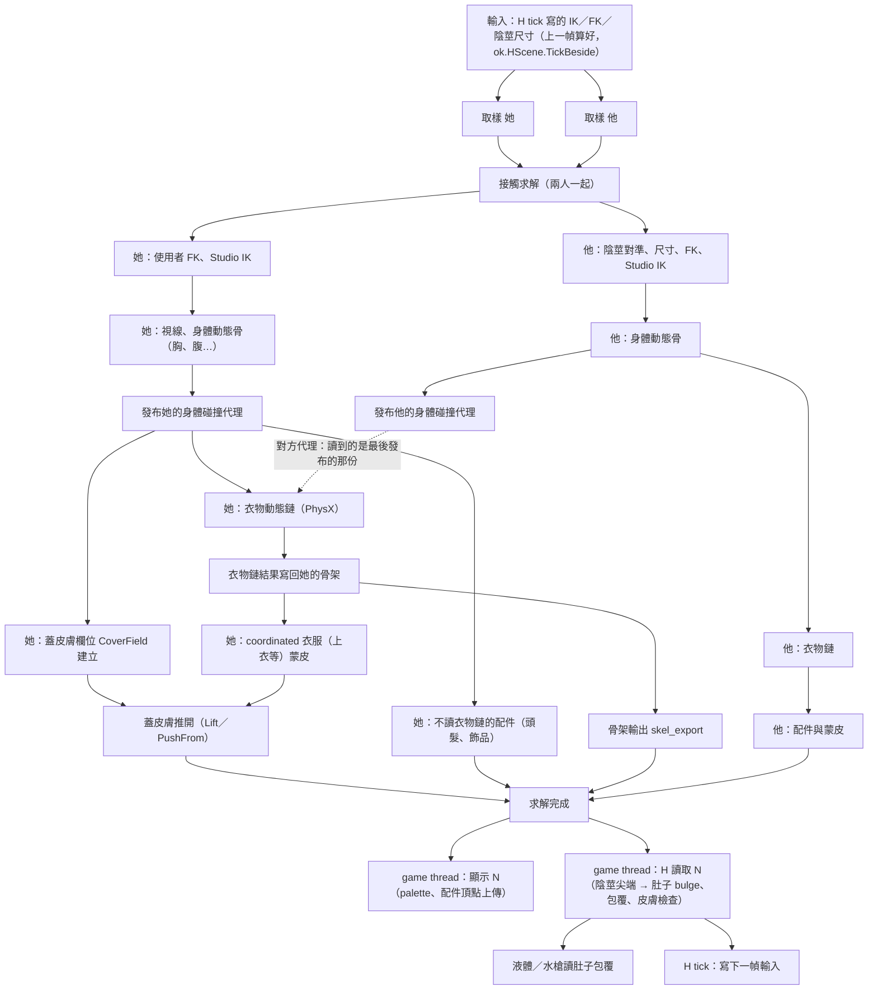

# 一對一：一幀內必須做完的計算與相依關係

2026-11-10 整理（E 組 e-120fps）。場景：街區沙盒、雷電將軍、背面騎乘位抽插。時間取自 native trace（EGalPerf100／101，commit 69469134e）；`pair.solve` 同場平均約 5.4 ms。

前提（使用者要求）：兩個角色、肚子變形、液體必須是同一幀的結果，不能有一個晚一幀。所以「求解 N → 顯示 N → H 讀取 N」整條都在同一幀。

## 一幀的流程

## 必須依序的（硬相依）

| # | 步驟 | 要等什麼 | 為什麼 | 時間 |
|---|---|---|---|---|
| 1 | 取樣（兩人各自並行） | 上一幀 H tick 的輸入 | Animator 狀態、IK 目標、參數 | 0.87 |
| 2 | 接觸求解 | 兩人都取樣完 | 兩副骨架一起解（MotionIK、身高差、插入位置） | 0.64 |
| 3 | FK／陰莖／Studio IK（兩人並行） | 接觸結果 | IK 要在接觸改過的骨架上重解 | 約 0.15 |
| 4 | 身體動態骨 | 自己的最終骨架 | 胸、腹等擺動跟著身體 | 0.3 |
| 5 | 衣物動態鏈（她） | 身體動態骨後的骨架與碰撞代理 | 衣擺要撞到動過的胸、腿 | 1.3 |
| 6 | coordinated 衣服蒙皮 | 衣物鏈結果寫回骨架 | 雷電上衣的骨頭就在衣物鏈裡 | 0.13 |
| 7 | 蓋皮膚推開 | 6 的頂點＋CoverField（身體表面＋肚子） | 衣服不能穿進皮膚 | 0.5～0.7 |
| 8 | 顯示、H 讀取 | 整個求解完 | 同一幀：身體、肚子、液體一致 | game thread |

1～7 是目前求解的最長路徑：加總約 4.0 ms；實測 5.4 ms，差的約 1.4 ms 是執行緒交接空檔、配件準備、骨架輸出等，還沒逐項拆開量。

## 不在最長路徑上（已經並行或可以並行）

- **他整條動態**（身體、衣物、配件）與她的整條並行；他的比她短。
- **CoverField 建立**：只需要她身體動態後的骨架，和衣物鏈並行。
- **頭髮、飾品**（不讀衣物鏈骨頭的配件）：和衣物鏈並行（`OK_ACC_EARLY`）。
- **骨架輸出 skel_export**：只有顯示用，和 coordinated 蒙皮並行就可以（目前是串在衣物之後、配件之前）。

## 軟相依（現在沒有屏障）

- **對方的身體碰撞代理**：她的衣物鏈會撞他的身體（反之亦然），讀的是 PhysX 群組裡最後發布的那份。兩人動態並行，所以可能是這一幀的，也可能是上一幀的，看誰先發布。要嚴格同幀就得加屏障（兩人都發布完才開始衣物鏈），代價是她的衣物鏈要等他的身體動態。
- **H tick 寫的輸入**：已經晚一幀進求解（TickBeside），畫面的同幀一致不受影響。

## 每一段的下限

| 段 | 時間 | 能不能再縮 |
|---|---|---|
| 取樣 0.87 | 她的 AnimatorModifiers 0.43，含 Studio IK 依設計跑兩次 | 拆 Animator 內部（曲線、modifier）並行 |
| 接觸 0.64 | ContactFreeze、CorrectBefore | 演算法層面，要逐項看 |
| 衣物鏈 1.3 | PhysX：Prepare 0.44、Simulate 0.2、After 0.17、Finish 0.13；Rust 包裝 0.3 | 拆 scene 並行（會改變鏈與鏈互撞的結果，工作樹有 `OKPhysXSecondary.BatchSplit` 草稿，未量測）；或減少 Prepare／Finish 的逐鏈工作 |
| 蓋皮膚 0.5～0.7 | Lift 0.2、PushFrom 0.3～0.47 | PushFrom 的擴環與翻面還是串行 |
| 空檔約 1.4 | 執行緒交接、準備 | 要先拆開量 |

## 可以留給下一幀的資料

畫面上看得到的東西都要同一幀，所以「晚一幀才算」只適用於看不到的輸入。能省時間的主要是前兩類：結果不變的直接快取，以及用上一幀的結果當起點。時間都還沒單獨量過。

### 1. 結果不隨幀變：算一次留著（結果完全相同）

只有換衣服、穿脫、隱藏部件、換姿勢、換卡時才要重算。

| 資料 | 現在 | 在哪 |
|---|---|---|
| 同一配件多個 renderer 的最大厚度合併 | 每幀建 `HashMap<(String,String),f32>`，再逐件套回 | `update_dynamic_accessories_pass` Scope 45 |
| 共用求解的 leader 分組 | 每幀用 `(String,String,Option<String>,[u32;16],Vec<i64>)` 當 key 建表、clone `particle_ids` | 同上 Scope 46 |
| 哪些配件可以和衣物鏈並行 | 每幀算衣物鏈動到的骨頭集合、名字比對 | `early_accessories` |
| 姿勢設定驗證 | 每幀 `validated_pair_setups`、`setup_from_index` 查表 | `h_playback.rs` Scope 0 |
| CoverField 的空間格子 | 每幀重新配置 `grid: Vec<Vec<u32>>` | `cover.rs` `from_still` |

前三項在她 Late pass 的準備裡，就在衣物鏈後面的最長路徑上（`OKAnim.Profile` 第 18 格「配件準備」）。拓樸資料（CoverStill、頂點鄰接）已經快取了。

### 2. 用上一幀的結果當起點（結果會有微小差異）

| 資料 | 想法 |
|---|---|
| 蓋皮膚：上一幀被推開的頂點集合 | 這一幀先從那些頂點和鄰居開始擴環，不用每幀從全部頂點篩 |
| 接觸求解（ContactFreeze、CorrectBefore）的修正量 | 以上一幀的修正當初值，迭代次數可能減少 |
| PhysX 每條鏈對身體膠囊的 clearance | 已經有 `BodyClear` 跨幀；Prepare 0.44 ms 主要是逐粒子重算，可以只在動畫姿勢變化大的粒子重算 |

### 3. 可以晚一幀（看不到的輸入）

- H tick 寫的 IK／FK／陰莖尺寸：已經晚一幀（TickBeside）。
- 對方的身體碰撞代理：現在就可能是上一幀的；可以明確規定一律用上一幀，兩人動態之間就完全沒有相依。
- 不行晚一幀的：頭髮、飾品、骨架輸出、CoverField 的身體表面。這些晚一幀，快速抽插時會看到頭髮或衣服跟身體分開、穿進皮膚。

### 實作結果（2026-11-10，EGalPerf105／106，同場 A/B）

- 第一類（`AccCache`，`OK_ACC_CACHE=0` 關閉）：「哪些配件可提前」每幀 0.18 → 0.03 ms；厚度合併、leader 分組只在部件改變時重算；指紋本身每幀約 0.036 ms（兩個角色、所有 pass 合計）。姿勢設定驗證本來就有快取（`setup_from_index`），沒改。接觸求解每幀複製整個姿勢的所有 state，改成只複製正在解的那個（結果相同）。
- 衣物 PhysX 拆成最多 4 個 scene 平行（`OKPhysXSecondary.BatchSplit`，1＝舊行為）：同場 6.54 → 6.02 ms。切換 split 時鏈換 scene 會在多執行緒同時刪同一個 scene 的 actor 而崩潰，已改成換 scene 的鏈先在單執行緒拆掉、每個 part 求解時持有自己的鎖。
- 第三類：對方身體碰撞代理一律讀這一幀開始時（`SetGroupFrame`）的那份（`OKPhysXSecondary.PartnerLastFrame`，0＝舊行為）。
- 第二類檢查後：接觸求解（FinalIK）和原作一樣每幀從動畫開始、固定迭代次數，用上一幀當初值不會減少工作，也會偏離原作，沒做。PhysX clearance 有逐幀的平滑狀態（`BodyClear`），跳過重算會改變結果，距離計算本身很便宜，沒做。蓋皮膚的 `push_at` 改成只看上一幀推過的頂點、周圍兩圈、加上其餘頂點每幀輪流 1/4（`OK_COVER_WARM`，預設 4；0＝每幀全看）：新碰到的地方最多晚 4 幀才推開。EGalPerf107 同場：`push_at` 合計 1.01 → 0.94 ms／幀、求解 4.70 → 4.65 ms，省得不多，大部分要看的頂點本來就在推開範圍和周圍兩圈裡。
- ABA（105／106 各重開兩次）：同一版不同次啟動可差 124 對 158 FPS，慢的是編完後第一次啟動；跨版本比較要重開多次。

要到 3 ms，最長路徑上這五段總共要再省約 2.4 ms。只靠衣物鏈（最多省到 0.3～0.5）不夠，取樣、接觸、蓋皮膚和空檔都要一起縮。
