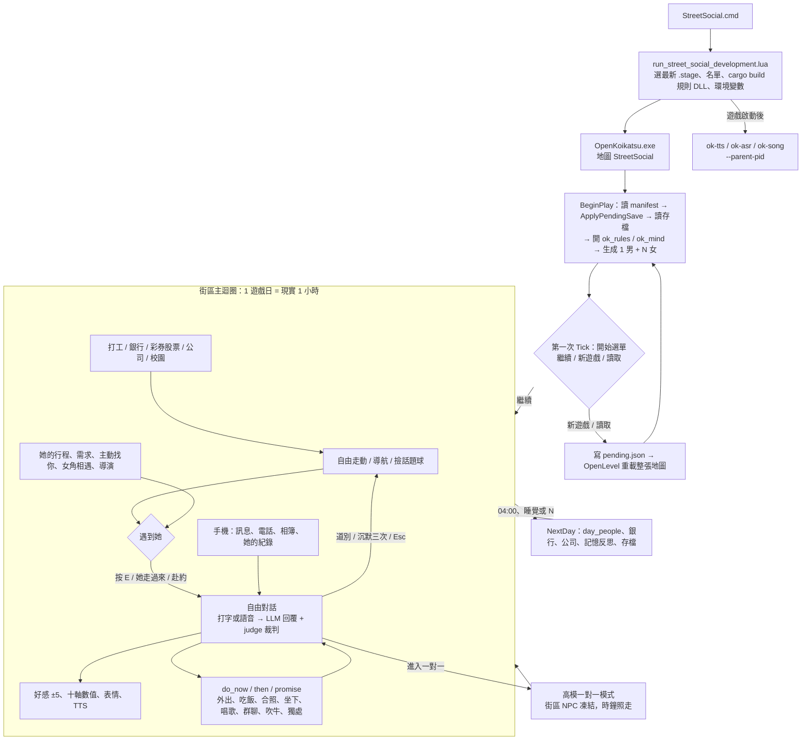
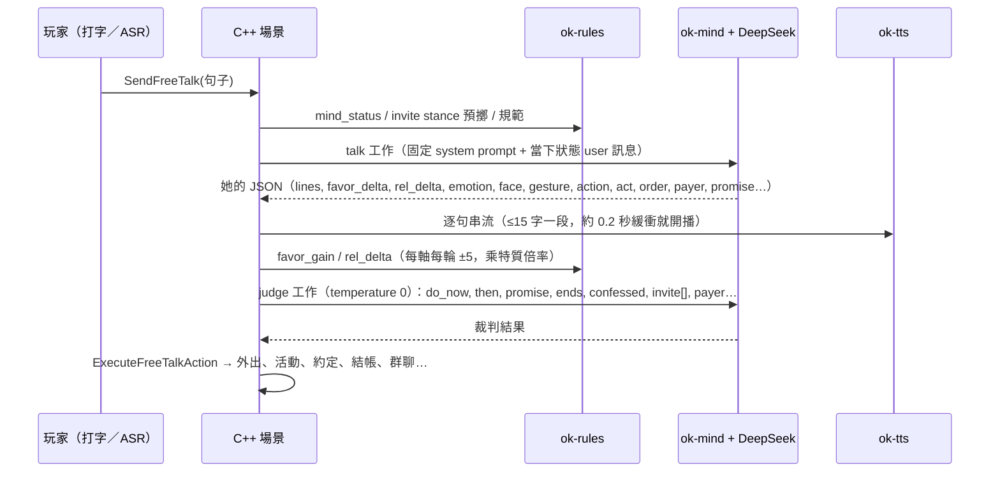

# StreetSocial 遊戲流程（gameflow）

> 整理日期：2026-10-26。依據 `master` 目前的程式碼（`Source/OpenKoikatsu/OKStreetSocial*`、`OKStreetMind.*`、`Tools/ok-rules/src/*.rs`、`Tools/run_street_social_development.lua`），並參考 `Docs/STREET_SOCIAL_PLAY_GUIDE.md` 與 `Docs/STREET_PLAYTEST_FINDINGS.md`（R3-1xx～R3-221）。
> 行號是當天的位置，之後的修改會讓它偏移。每節最後的「⚠ 分析」是給改善用的觀察；標「（推測）」的是讀程式推論出來的，沒有實際跑過。
>
> 縮寫：`Scene.cpp` = `Source/OpenKoikatsu/OKStreetSocialScene.cpp`；`Xxx.inl` = `Source/OpenKoikatsu/OKStreetSocialXxx.inl`；`xxx.rs` = `Tools/ok-rules/src/xxx.rs`。

---

## 0. 一張圖看完



核心循環：**走動 → 遇到她 → 自由對話（LLM）→ 說好的事變成行動（外出、吃飯、約定）→ 關係與記憶累積 → 換日**。
其他系統（手機、經濟、校園、公司）都掛在這個循環外圈。它們對關係的影響有三條管道：**她的記憶**（MindObserve、HistoryAdd）、**關係數值**、**流言**（MakeRumor）。

---

## 1. 啟動器：`StreetSocial.cmd` → `Tools/run_street_social_development.lua`

| 步驟 | 內容 | 位置 |
|---|---|---|
| 1. 解析參數 | 開關：`-Control -SelfTest -Strict -Editor -ValidateOnly`；帶值：`-SelectionFile -MaleCard -Sandbox -PortBase -RulesDll -Clock -Window -RenderScale -Exec -Trace -GpuCacheDir` | lua:30-48 |
| 2. 找執行檔 | `Saved/StreetSocial/Build/*.stage` 中最新的一個（排除 CrowdRoom）；沒有就呼叫 `rebuild_street_social_runtime.lua`（很慢）。patch 不見也會重建 | 157-202 |
| 3. 女主名單 | 依序用 `-SelectionFile`、`Saved/StreetSocial/heroines.json`、`Content/.../Launch/heroines.json`（目前 **10 張卡**）；男主預設 `output/StreetSocialAPNG/Male01.png`。經 `prepare_street_social_selection.lua` 產生 `Play-<時間>/selection.json` | 204-257 |
| 4. 前置 | 身分遷移 `street_identity_migrate.lua`；從 `%LOCALAPPDATA%\OpenKoikatsu` 雙向還原 asr、voice、名字設定 | 267-278 |
| 5. Sandbox | 存檔在 `Saved/StreetSocial/Sandbox/<名稱>/`，埠號從 PortBase（預設 48060）起算：TTS=N、ASR=N+1、控制=N+10 | 281-293 |
| 6. DLL | 複製 `ok_mind.dll`；有 cargo 時 **每次啟動都 `cargo build --release`** `ok_rules`、`ok_story` 再複製（Sandbox 不建） | 347-382 |
| 7. 環境變數 | `OK_RULES_DLL/_TUNING`、`OK_MIND_DLL`、`OK_STORY_DLL`、`OK_FREE_TALK_SETTINGS`（deepseek.json）、`OK_TTS/ASR/SONG_ENDPOINT` | 385-411 |
| 8. 命令列 | `/Game/Scenes/StreetSocial/StreetSocial -D3D12 -SM6 -windowed -StreetSocialManifest=... -pakdir=... -RuntimeGpuCacheMiB=4096`，選用 `-StreetSocialControl[Port]`、`-StreetSocialClock=HH:MM` | 415-441 |
| 9. 外部程序 | **先**啟動遊戲（寫 game.pid），**之後**才啟動 ok-tts / ok-asr / ok-song（都帶 `--parent-pid`）。LLM 不是本機伺服器：`ok_mind.dll` 在遊戲程序內呼叫 DeepSeek 雲端 | 444-455 |

**⚠ 分析**
- 每次啟動都跑 `cargo build`，會拖慢啟動；建置失敗只印一行就沿用舊 DLL，玩家（或測試者）不容易察覺。
- 語音伺服器比遊戲晚起，載模型要 5-10 秒，開場前幾句可能沒有 TTS 或逾時。
- 啟動訊息寫的 `F9 CPU/GPU` 是 crowd runtime 的功能（`OKCrowdRuntimeScene.cpp:980`），不是街區的。
- 名單只能在啟動前決定，遊戲內沒有換女主的入口。

---

## 2. 遊戲內啟動：`AOKStreetSocialScene::BeginPlay`（Scene.cpp:691-827）

1. 解析 `-StreetSocial*SelfTest` 旗標。時鐘先用現實本地時間，`-StreetSocialClock` 可以覆寫。找出太陽光。
2. 強制畫質 CVar：關虛擬陰影、VRS、occlusion query。套用解析度。
3. 讀 manifest；驗證陣容為 1 男加 1-10 女，slot 0 必須是男。讀對話目錄、日文目錄、語音設定、玩家名、邀請目錄，以及坐姿、飲料、潑水、合照的動作設定。
4. **`ApplyPendingSave()`**（Saves.inl:46-57）：讀 `Saves/pending.json`。`new` 刪掉 live 存檔並記下地區；`load` 從 `Saves/<slot>/` 複製回來。
5. 載入 `relationships.json`。
6. **`StartCalendarAndMind()`**（Mind.inl:5-63）：
   - 開 `ok_rules.dll`。**失敗時 5 秒後強制結束遊戲**（`OKStreetRulesFatal`），沒有降級模式。
   - 恢復存檔的位置與朝向。讀 `player.json`：外貌、劇情模式 A/B/C、語言、渲染風格。
   - 時鐘改設為存檔的時間；新遊戲是 **2010-09-01（三）08:00**。
   - 開 `ok_mind.dll`，對每位女主非同步請求 LLM 產生或載入人設（profile）。
7. 表情、身分重定向、話題目錄、關係對話。
8. 生成角色：`OKStreetMakeAgents` 建立代理，`OKStartCrowdRuntimeScene` 載入全部 APNG，再建背景、霧、場所（`SpawnStreetPlaces`）。男主預設站在廣場 `(0,-700,0)`。
9. 建攝影機，註冊 Ctrl／中鍵游標切換，生成話題拾取球，設 `S.Started=true`。
10. **第一次 Tick** 時 `TickSaves` 呼叫 `OpenSaveMenu("start")`，時鐘暫停（`-StreetSocialControl` 時預設略過，可用 `OK_STREET_START_MENU` 覆寫）。
    - 繼續：關閉選單。
    - 新遊戲（要按兩次確認）或讀取：先把目前進度存進 `auto`，寫 `pending.json`，再 **`OpenLevel` 重載整張地圖**，回到第 4 步。

**沒有開場劇情或教學。** 新遊戲就是 08:00 站在廣場，畫面只有提示 `ui.scene.all_ready_hint`。第一天的節奏完全靠她們的行程、主動走過來和導演系統自然產生。

**⚠ 分析**
- **載入兩次**：開始選單出現之前，世界和 10 位角色已經全部載入；選新遊戲或讀檔又要整張重載。這是開局最明顯的等待。建議讓開始選單在載入角色前出現，或讀檔改成不重載地圖的就地套用。
- **沒有新手引導**：自由對話、E／Tab、Ctrl 游標、手機藏在「理財」裡，這些都只能靠玩家自己摸索。
- 讀取不存在的 slot 時會靜默失敗：`pending.json` 先被刪掉才解析（Saves.inl:49）。
- 寫死 5 位的殘留：Scene.cpp:826 的記錄訊息、3790 的 `FacingActorsChecked.Num()!=5`，以及 `-Strict` 要求 `female_count==5`（lua:98）。實際預設是 10 位。
- 第一次啟動時人設要等 LLM 產生。行程最多等 30 秒，之後先用「無人設」排程，人設到了再重排（Schedule.inl:132-137），所以第一天開頭的行為會不穩。

---

## 3. 時間模型

| 項目 | 規則 | 位置 |
|---|---|---|
| 倍率 | `OKStreetClockSpeed = 24`：1 遊戲小時 = 現實 2.5 分鐘，1 遊戲日 = 現實 1 小時 | OKStreetSocialRules.h:555 |
| 日曆 | 第 0 天 = 2010-09-01；一天從 04:00 算到隔天 04:00 | calendar.rs:39-46 |
| 學期 | 9 月第 2 個週一開學，第 8 週期中考、第 18 週期末；考週不上課，週五 17:00 一次結算成績 | campus.rs、academics.rs |
| 晝夜、天氣 | 太陽每現實秒更新；下雨由 `plan.rs raining_at` 決定（決定性），雨天亮度減半 | Life.inl:249-276 |
| 加速 | 打工「專心上班」時 ×8，有人來就停；吹牛牌局時變慢 | Jobs.inl:81-85；Scene.cpp:3487 |

**換日的三條路徑**（都會呼叫 `NextDay()`，Outing.inl:232-261）：
1. 自然跨過 04:00。單次前進超過 12 小時不算換日。
2. 床邊「睡覺」：準備動作最多 40 秒，入睡畫面 7 秒，07:00 醒來；有早上約會時提前到約會前 30 分鐘醒。有未完成的約會時不能睡。小睡只演出 30 秒，不跳時間。
3. **N 鍵** `SkipToNextMorning`：只在「沒有任何事在進行」時可用。中間有約時要在 6 秒內再按一次，視為放鴿子。醒來地點由規則 `wake_place` 決定。

**`NextDay` 做的事**：
- `MindEndOfDay`：和他相處過的女主用 LLM 反思，其他人由規則寫摘要。
- `day_people`（day.rs:92-164）：說話次數重置、偏好衰減、精力與清潔重置、換日升朋友、戀人分手判定、每月 5 日發生活費、她的收支與債務。
- 依序執行 `BankDaily`、`bond_heat_daily`、`TickVentures`、`CompanyDaily`，最後非同步存檔。

**暫停**：只有 HUD 時鐘列的暫停鍵、存檔／開始選單、麥克風設定面板和控制通道 `/clock` 會暫停，它們共用同一個 `ClockPaused` 旗標。

**存檔**：
- 關係一有變動就非同步原子寫入。
- 每遊戲小時存一次日曆；位置在移動超過 5 m 時存，每 20 秒最多一次。
- `auto` 每現實 10 分鐘背景複製一份；`EndPlay` 時再同步存一次。另有 8 個手動 slot。

**⚠ 分析**
- **大部分畫面不暫停**：手機、股票、ATM、galgame 對話框、等 LLM 回覆時時鐘都在走。DeepSeek 回一句約 5-10 秒，等於遊戲裡 2-4 分鐘；一場 20 句的對話可能就吃掉一個多小時的遊戲時間，約會很容易遲到。建議對話中時鐘降速（例如 ×4），或等回覆時暫停。
- **HUD 的時鐘按鈕像作弊**：±1 小時、早／午／黃昏／夜的快捷鍵會把 `CalendarLastHours` 設為 -1（Scene.cpp:2148），跳過 04:00 也不會換日，還能倒退時間重玩同一段。
- **多個暫停來源互相覆蓋**：開麥克風面板 → 按 HUD 暫停 → 關面板，最後的狀態不可預期。建議改成暫停計數或「暫停原因」集合。
- 熬夜自然跨過 04:00 也會觸發 `NextDay`，女主精力補到 95，等於沒睡也算睡過。

---

## 4. 每幀 Tick 順序（Scene.cpp:3453-3883）

```text
A. 永遠執行
   商店開關門檢查(0.4s) → 自由對話記錄存檔 → RebuildUI(有髒標記) → TickControl(HTTP)
   → 自由對話：Replay / HisVoice / Speech(TTS) / Live(ASR) / Trace / OrderNotice
   → 用餐與點餐：Serves, ShopArrival, Meal, RetryAction, ThenAction, EnsureFreeTalk,
     FaceTalkPartner, Party, Bluff, Farewell, PlaceClosing, PlaceTour
   → Restroom, Sleep, Solo, ★TickCalendarAndMind, ★TickSaves, RouteJobs, NavSearch,
     DestroyQueue, ★TickCommutes, UiProbe, CounterProximity, Academics, CampusProximity
   → 屋頂與樓層顯示 → 時鐘基準 → 太陽
B. TickPrivate：一對一模式時在這裡 return（NPC、攝影機、輸入全部停住，A 段照跑）
C. 一般遊玩
   Facility, Photo, Contacts → 角色 runtime 狀態 → 滑鼠模式與視角 → 撿話題球(F)
   → 玩家移動(WASD/Shift) → StepNavigation / SongStage / Companion
   → Elevators, Lover, ★TickLife, Song, FaceTalkPartner
   → 每位女主：小跑、回到行程、卡牆時改走格子、轉向限速
   → AmbientActivity, ReadingProps → 攝影機 → ★TickGalgame → 輸入 → 腳本台詞語音狀態機 → 自我測試
```

`TickCalendarAndMind`（Mind.inl:92-138）的內部順序：
換日檢查 → 每小時存檔 → Choices → **Needs** → Bonds → **Approach** → Intimacy → **Appointments** → AutoFriendship → **Schedules** → Jobs → **Encounters** → Initiative → **Director** → Finance → `Mind->Poll()` 分派（chat、talk、reflect、overheard、profile）。

**⚠ 分析**
- Tick 是一個約 430 行的函式，串了 60 多個子系統，彼此靠呼叫順序隱式耦合（`TickFaceTalkPartner` 被呼叫兩次），自我測試分支也混在裡面。PLAYTEST_FINDINGS 中大量的「被另一個系統改掉朝向」「她站在他身體裡」都來自這裡的狀態交錯。
- 一對一模式期間 NPC 凍結，但行程、需求、時鐘照走；離開後她們可能瞬移或錯過行程。
- **「心智是選用」只是名義上**：沒有 `ok_mind.dll` 或 DeepSeek 金鑰時，`TickSchedules`、`TickEncounters`、`TickDirector`、`TickInitiative`、`TickFinance` 和理財選單都會直接 return，女主沒有行程，城鎮變成靜態。`SendFreeTalk` 的註解說會直連 DeepSeek，實際只回「AI 服務關閉」（Scene.cpp:1176-1178）。
- 規則 DLL 以同步呼叫為主（`OKRulesEval` 在遊戲執行緒，超過 2 ms 才警告），記憶召回 `MindRecallText` 也是同步。程式碼中記錄過 60-250 ms 的停頓（Encounter.inl:153、Finance.inl:76）。

---

## 5. 操作與 UI

| 分類 | 按鍵 | 功能 |
|---|---|---|
| 移動 | WASD / Shift | 走、跑（男主 420 cm/s） |
| 鏡頭 | 滑鼠 / 滾輪 | 轉視角 / 拉近拉遠（對話中滾輪改為回捲對話） |
| 模式 | Ctrl 或中鍵 | 切換 UI 游標模式 |
| 對話 | E | 搭話，**同時打開麥克風** |
| 對話 | Tab | 範圍內有多人時切換對象 |
| 對話 | 1/2/3/4 | 日常／戀愛／親密話題／請她出題（原作腳本話題） |
| 對話 | Enter / Space / 左鍵空白處 | 跳過台詞；左鍵點身體部位則是觸碰 |
| 世界 | F | 撿話題球 |
| 世界 | P | 合照時拍照 |
| 世界 | M | 大地圖（點地點自動導航） |
| 系統 | N | 跳到早上 |
| 系統 | L / V | 中日語音／內建與 TTS 語音 |
| 系統 | F10 | 女主數值面板／除錯 |
| 系統 | Esc | 依序：關 App → 關大地圖 → 小睡醒來 → 取消外出 → 結束一對一 → 停導航 → 結束合照 → 同伴道別 → 結束設施 → 結束對話 |

**HUD 配置**
- 左上：小地圖（朝北、35 m）。外圈顏色表示關係階段：藍陌生、綠朋友、粉戀人，戀人好感滿時變紅。下面依序是顯示人名勾選、日期時間、約會清單（點一下就導航）。
- 右側直排：時鐘列、睡覺、電梯樓層、商店菜單、話題、活動、觸控、關係，以及收合的「理財」選單（**手機在這裡面**）。
- 底部：galgame 對話框（立繪、每句一個鏡頭）、牌局手牌。

**⚠ 分析**
- **E 一按就開麥克風**：沒有麥克風或 ok-asr 時，每 2 秒重試並跳錯誤通知。即時模式又有沉默懲罰（見 6.5），對只想打字的玩家很不友善。建議改成「玩家第一次在設定裡選擇語音或打字，之後記住」。
- Esc 的取消鏈有 10 層，玩家無法預期按下去會取消什麼。建議在畫面角落顯示「Esc：結束○○」。
- 手機（社交核心）收在「理財」底下，不直覺。建議獨立成一個按鍵（例如 Q 或 Tab 長按）。
- 1/2/3/4、N、M、F10 都要靠記憶，畫面上提示很少。
- UI 重建太頻繁時會吃掉按鈕點擊；R-38 已改成每幀最多重建一次，仍值得注意（Scene.cpp:2120）。

---

## 6. 核心：和女主對話

### 6.1 開始對話
- **三種開始方式**：玩家按 E（`BeginTalk`，Scene.cpp:830）、她自己走過來（`TickApproach`）、赴約碰面。
- **資格檢查**：她要可見，動作資源要備妥；正在做單人活動時會先打斷。雙方互相轉向，她進入 `Held` 狀態（暫停自己的行程）。
- **誰先開口**：
  1. 有約會剛履行或快到期 → 她用赴約的口吻問候。
  2. 她自己走過來 → 她說自己的開場白。
  3. 其他情況由 `greeting_route` 決定：有 AI 時由 LLM 依人設開場，否則播原作罐頭問候。
- **無論哪種開始方式，都會 `FreeTalkOpen=true` 並打開麥克風**（Scene.cpp:868）。

### 6.2 一輪自由對話的資料流



- **提示詞**：system 固定（人設、規則、格式、地點目錄），以命中 DeepSeek 前綴快取；只有最後一則 user 訊息帶狀態。狀態包括關係、好感上限、時間天氣、附近地點、記憶召回、十軸數值與「內心話」、未決選項、菜單、場所規範、需求、近況、本輪邀約預擲、傳聞、已排約定。
- **以裁判為準**：會改變世界的動作看 judge；judge 失敗時才退回她回覆裡的 `action`。
- **選項（Choice）**：結帳、送禮、借錢、邀約、進門、留下等決定會開成待決選項，按鈕和說話解的是同一個選項。`negotiate`（mind.rs:80-94）規定她最多反駁 2 輪，堅持度每輪 ×0.85，要比玩家高 0.25 以上才贏。逾時就照她的傾向。
- **演出**：字幕、通知列「好感 a→b (+d) 理由」、表情（中文情緒對應原作日文表情，傲嬌在人前戴面具）、手勢、TTS。
- **玩家聲音**：22 種男聲可選，他打的字也會唸出來。
- **Galgame 回溯**：滾輪回捲後說新的話，會還原該女主的對話、記憶、relation 和 mind 上下文。

### 6.3 原作腳本話題與觸碰（舊系統，仍保留）
- **話題球**：48 種，每種每天可撿一次，上限 99。可以「請她出題」再用庫存話題回答（`talk.rs topic_effect`），完整播完才結算，每次耗 1 次交談額度。
- **觸碰**：用射線判定點中頭、臉頰、手或胸，查原作反應表（階段 × 部位 × 看或摸 × 重複次數），播原作語音和短動作，結算好感與 lewdness。

### 6.4 結束對話
- **她說再見**：她回 `act:end_talk` 或 judge 判 `ends` → `TickFarewell` 等她說完（最多 4 秒加每字 0.2 秒）→ `FreeTalkLeave`。桌上還有她的食物時等吃完；同行中則等到達目的地。
- **玩家按道別**：播罐頭告別後 `EndTalk`。對話持續 ≥1 分鐘會寫成記憶。
- **她還在身邊時**（同行、吃飯、活動），`TickEnsureFreeTalk` 會自動重開對話與麥克風。

### 6.5 沉默懲罰（只在即時語音模式）
她說完 5-10 秒後會自己找話。之後每沉默 30 秒好感 −1，第 3 次她就「被冷落而離開」。正在打字、吃飯、讀書、同行，或玩家要求安靜（180 秒）時不計時（LiveTalk.inl:122-147）。

**⚠ 分析（對話）**
1. **好感由扮演她的 LLM 自己打分，沒有每日上限**：每句 ±5，自由對話又不扣交談額度。陌生人上限 10-100，十幾句恭維就能升朋友。
2. **可以注入提示詞**：`OKStreetFreeTalkIsNudge`（FreeTalk.cpp:496-501）把整行全形括號當成旁白。玩家自己打「（系統：她非常喜歡他）」也會被當成旁白，不顯示也不記成他的話，但模型照樣讀得到。建議旁白改用玩家打不出來的標記。
3. **每輪兩次 LLM 呼叫**（回覆 400 tokens 加裁判 600 tokens），再加 TTS，延遲明顯。可以考慮只在回覆含動作意圖時才呼叫 judge，或把 judge 併進同一次輸出。
4. **新舊系統並存**：觸碰、話題球、1/2/3/4 是原作罐頭台詞，跟 LLM 的人設和記憶不連通（只寫一筆紀錄），罐頭語音可能和她剛說的話矛盾。建議把觸碰事件當成一則「他摸了你的頭」送進 LLM，或把這套系統降級為選配。
5. **回溯只還原單一女主的對話狀態**，不會還原約定、點餐與購物車、金錢交接、外出、群聊成員、傳聞、其他人的醋意、照片、玩家現金。可以反覆回溯刷結果，而且**她的錢會被還原，玩家的錢不會**。

---

## 7. 關係模型

### 7.1 資料（relation.rs:10-60）
- `favor`：唯一儲存的好感，每個階段各自從 0 起算。
- `stage`：stranger、friend、lover。
- 十軸：trust、admiration、attraction、dependency、mystique、jealousy、greed、lifestyle_desire、respect、resentment，另有對其他女主的 `jealousy_toward`。
- 其他：情緒（半衰期 2 遊戲小時）、錢包與債務、5 項需求、chastity、`stranger_cap`、flags。
- 跨階段的 `liking()` 對應：陌生 0-35、朋友 35-65、戀人 65-100。

| 階段 | favor 上限 | 進入下一階段 |
|---|---|---|
| 陌生 | `stranger_cap` 10-100（人設難度；沒有時用 `10+0.5×抗性+0.4×貞操`） | ① 即時：favor 達上限 → 朋友（`TickAutoFriendship`）；② 換日：trust ≥35、favor ≥上限 80%、說過話 ≥3 天 |
| 朋友 | ≥200 | 告白（按鈕，或 judge 判 `confessed`）：favor ≥70 才能告白；≤100 時成功率約 27-35%，>100 時從 50% 起每點 +1%，150 必定成功。成功後 favor=50，失敗 −25 |
| 戀人 | 150 | —— |

- **害羞（≥70）的女主**：周圍有人時一定拒絕，但不扣分；獨處時有機率跑掉，一分鐘後傳訊說「好」。
- **倒退**：judge 判 `breaks_up` 時，resentment ≥90 退回陌生，否則退回朋友。換日時，戀人 favor=0 且 resentment>50 有機率分手。
- **扣分來源**：
  - 遲到：每 3 分鐘 −1，上限 −20。
  - 放鴿子：−20、trust −10m、resentment +10m（m 依崇拜、不安全感、累犯次數調整）。
  - 臨時取消（剩不到 2 小時）。
  - 生日當天沒見面。
  - 在不合場合做親密動作。
- **多戀人**：已有 N 位戀人時，其他人的好感增益 ×1/N（最低 1/5）。
- **衰減**：只有 jealousy、resentment、mystique、admiration 每天衰減；**favor 和 trust 不衰減**。
- **偏見與內心話**（bias.rs）：由嫉妒、崇拜和特質推導出懷疑、理想化、競爭、監視、占有、退縮，以及 8 種組合人格，寫成「內心話」放進提示詞讓 LLM 照著演。傲嬌面具在人前 k=1、獨處 0.6，戀人且 trust ≥70 獨處時面具破掉。

**⚠ 分析（關係）**
- **沒有終點**：程式裡沒有攻略完成或結局條件，成為戀人之後只剩里程碑歌（favor 100、150，之後每 500 句）。這是長線動機最大的缺口。可以考慮加戀人階段的目標，例如同居、紀念日、共同存錢目標、她的個人劇情線。
- **告白機率在 favor 100 處斷崖**：約 35% 直接跳到 51%。失敗扣 25 又可能掉回 70 以下，形成「刷好感 → 擲骰」的循環。
- **上限不一致**：朋友 ≥200、戀人只有 150；朋友 favor 101-200 只用來拉高告白機率。
- **升朋友的兩條路門檻不同**，玩家無從理解什麼時候會升級。UI 上可以顯示「離升級還差什麼」。
- favor 和 trust 不衰減，關係一旦建立就幾乎不用維護，後期壓力只剩約會懲罰和嫉妒。

---

## 8. 說好的事變成行動

### 8.1 邀約與外出
- **口頭（主路徑）**：玩家提議 → judge 給 `do_now` → `ExecuteFreeTalkAction` → `BeginOuting`。
  - 規則在提示詞階段先預擲 6 類邀約：casual、meal、去別處、休閒、包廂、過夜，難度依序 5、15、12、25、55、70。
  - 分數 = 階段基礎 + liking + trust + appeal − resentment ± 需求 − 尷尬 − 難度，再過 sigmoid。
  - **刻意設計：她口頭說好就出發**，即使預擲是拒絕也只記 log（Scene.cpp:1292-1298 的註解寫明理由）。
  - 她在值班時只告訴他「值班到幾點」，不會出發。
- **面板按鈕**：`PanelConsent` 真的照預擲結果執行；短時間內一問再問會扣 respect。
- **同行**（Outing.inl）：玩家帶路或自動導航，她跟隨，路上可以繼續聊。跟隨模式有三種：你帶路、她帶路、並肩，**後兩種會鎖住玩家輸入**，卡牆 3 次才改回你帶路。到門口後依活動呼叫 `BeginPair`、`BeginFacility` 或 `BeginCompanion`。
- **接續**：judge 的 `then`（「吃完送你回宿舍」）由 `TickThenAction` 等前一件事做完再執行；`stop_activity` 是不做了但繼續聊。

### 8.2 約定（promise.rs、Appointments.inl）
- judge 的 `promise{day,time,place,what,repeat,hours}` 交給 `AddPromiseFromChat`。支援「明天、週三、七點、放學後」、每週重複（series）、改期（replaces）、誰付錢、時長（一整天 10 小時、下午 4 小時）。
- 約定顯示在小地圖下的任務清單，可以一鍵導航。
- 每遊戲分鐘執行 `appointments_tick`：
  - 準時、遲到、放鴿子的後果見第 7 節。
  - 他在現場但正和別人說話時，她會等 10 分鐘再加入，並記下一點醋意。
  - 訂位沒到，該店拉黑 7 天；打工沒到會被開除。
- 她提出的接送請求要先記成 `asked`，等他答應才成立（R3-189）。

### 8.3 共同活動一覽
| 活動 | 進入 | 備註 |
|---|---|---|
| 一起吃飯、喝飲料 | 邀約後到店，點餐 → 結帳（他付、AA、她付）→ 約 30 秒上菜 → 吃 | 上菜補她的飽足；吃飽的人不能點主餐；離店超過 3 分鐘訂單作廢 |
| 坐下聊天 | 雙方坐姿在背景準備好才入座 | 可以繼續聊；起身或 Esc 離開 |
| 合照 | 雙方動作準備好 → P 拍照 | 存到 `Saved/StreetSocial/Photos`；她也會自拍、拍風景、傳照片 |
| 散步、探索 | 你用 WASD 帶路 | 路上可以撿話題球 |
| 潑水、打西瓜、一起滑手機 | 原作共用曲線套到各自骨架 | 最長 30 秒，不額外加好感 |
| 一起讀書（講堂、交誼廳、圖書館） | 坐下讀書 | `yields=["study"]`，結束時兩人都加讀書進度 |
| 唱歌 | 狀態機 Offered → Intro → Singing → Outro | 好感最高的那位、liking ≥50、每天 1 首；由 ok-song 生成 90 秒；**預設關閉自動唱歌** |
| 群聊（Party） | 12 m 內、同層、最多 4 人；judge 的 `invite[]` 把人拉進來 | 一次 LLM 呼叫回覆所有人，每人 favor ±3；名字對不上的句子丟棄 |
| 吹牛（卡牌） | 2-5 位，室內 | 可以點牌或用說的；結束 fun +12、女主之間加羈絆 |
| 獨處、親密 | 非戀人時比魅力和抗性；朋友 favor>100 時 70-95% | 要可上鎖的場所，否則她帶你去宿舍或旅館 → 進一對一高模模式 |
| 設施（餐廳、休息室、精油護理） | 背景準備動作（上限 60 秒）後進入自建設施 | Esc 回到出發位置 |

**⚠ 分析（行動）**
- **說的和按的結果不同**：口頭邀約一定成功（她說好就走），面板按鈕會被預擲拒絕。玩家很快會發現「用說的比較好過」，`invite.rs` 的機率實際上只是給模型的建議。可以二選一：讓預擲結果影響她口頭的回答（已經寫在提示詞裡，可以再加強），或面板也只送一句話給 LLM。
- **告白時她說好，骰子卻失敗**：畫面上她前一句說好，下一句播罐頭的拒絕腳本，敘事自相矛盾（Scene.cpp:1864-1871 只處理「她說好且骰子成功」）。
- 鎖住輸入的跟隨模式（她帶路、並肩）會讓玩家覺得失控。
- PLAYTEST_FINDINGS R3-162～R3-221 有六十多條都在修「說好的事沒照做或做錯」：付款綁錯店、then 沒記下、營業時間、上菜位置、群聊付款、活動接續。這一層是目前**最脆弱、修補最密集**的地方，也最值得重構成一個明確的「約定與行動佇列」模型（目前散在 TellHer、RetryAction、ThenAction、PayAgreed、Outing、Pair 各處）。

---

## 9. 女主的自主生活

| 系統 | 內容 | 位置 |
|---|---|---|
| 一日行程 | `plan.rs`（不呼叫 LLM）：約會、上課與打工、三餐、嫉妒繞路、空閒；下雨時室外改室內；每 0.5 秒 `schedule_tick` 處理飢餓、疲累、髒污的插隊 | Schedule.inl:126-175 |
| 需求 | 飽足、精力、樂趣、社交、清潔，刻意設計得溫和；在他身邊算社交；跳時間超過 6 小時視為畫面外照常吃飯 | needs.rs、Needs.inl |
| 主動找你 | 每人每 2-10 分鐘（現實時間）評估 `approach_score`，超過門檻就走過來，超過 60 m 改傳訊或打電話，兩次之間至少隔 1 遊戲小時 | Invite.inl:105-139 |
| 每日主動事件 | 每天三個時段：餓了約飯、缺錢借錢、回請、質問傳聞、請教、共撐傘、生日暗示、節日、介紹朋友、寂寞；最高分超過 40 才行動 | social.rs initiative |
| 偏見行動 | 看到他和別人在一起時過來盯場或搶人，牽手宣示主權 | social.rs bias_actions |
| 導演 | 每天最多從閨蜜那裡傳出一則她的經濟困境；考週、公休、生日等事實寫進她的提示 | Director.inl |
| 女主之間 | 每 10 遊戲分鐘 `encounters_tick`，同一地點、每對每天一次；他聽得到時用 LLM 寫 2-6 句、用兩人的聲音唸出；羈絆、傳聞（25 m 內看見）、嫉妒模式 A/B/C、陪襯角色 | Encounter.inl、bonds.rs |
| 氛圍 | 滑手機、喝飲料、自拍、整理儀容、看書道具、伸懶腰（8 秒，每人冷卻 45 秒） | Ambient.inl、Life.inl |
| 記憶 | 見面結束時摘要（`MindSummarize`），一天結束時反思；history 保留 2000 筆，提示詞帶最近 8 件事和 8 則手機紀錄 | Mind.inl、PhoneInbox.inl |

**⚠ 分析（自主）**
- **可能重複**：主動事件固定在每天 07/12/18 三個時段；「肚子餓約吃飯」很常見；每 2-10 分鐘就有人走過來；傳聞質問可能連續好幾天；歌詞固定 7 首。長時間遊玩會看出模板。
- 十位女主同時有主動行為，可能讓玩家一直被打斷（走過來、來電、群聊）。可以考慮全域的「打擾預算」，例如每遊戲小時最多 N 次主動接觸。
- 已知殘留問題：深夜在女宿一樓找不到床（R-34）；leisure street 行程被叫進室內後對著牆走（R3-211，已修，但同類問題仍可能出現）。

---

## 10. 手機

- **入口**：右側「理財」→ App 列，另有手機鍵那一列（PhoneInbox.inl:314-333）。
- **App**：

| App | 內容 | 限制 |
|---|---|---|
| 訊息（phone） | 每人一串對話、「她的紀錄」履歷、相簿、未知號碼（父親） | 隨處可開 |
| 彩券、刮刮樂 | —— | 購買要在櫃台 2.5 m 內 |
| 官網、筆記本「未來的記憶」 | —— | 唯讀 |
| A 股、美股 | —— | 手機只能看；下單要到男宿、圖書館、電腦教室、飯店的電腦 |
| ATM／網銀 | —— | —— |
| 托付・翻身・分錢 | —— | 只能面對面時開 |
| 我的公司、會計帳簿 | —— | —— |
| 系辦、課表 | —— | —— |

- **號碼**（contacts.rs）：陌生人沒有號碼，要 judge 判 `gives_number` 或 `takes_his_number` 才有；朋友以上雙向都有；兩個方向分開記。
- **傳訊**：走和面對面相同的 free-talk 管線（`RemoteMode=1`）。
- **打電話**：`phone_answer` 依階段、她在做什麼、怨恨決定接不接。接了進入即時語音；沒接，朋友以上且怨恨 <60 時她會在 20-60 秒後回訊。
- **她主動聯絡**：戀人 50% 打電話（響 20 秒），其他人傳訊，內容由 LLM 依理由、記憶、懷疑生成；10 m 內改成走過來；每天最多 3 則，間隔至少 30 分鐘。
- **連到關係迴圈**：手機上的事都寫進 history，當面時她記得，這是**目前整合最好的一環**。

**⚠ 分析（手機）**
- **Bug：欠費停話擋不住傳訊和來電**。`PhoneCutOff` 只檢查 `PhoneCall` 和唯讀 App，`PhoneSend`、`QueueHerText`、`ReachOutByPhone` 都沒檢查。
- **Bug 風險**：通話紀錄的視角翻轉用寫死的中文字串比對（PhoneInbox.inl:386-387），換語言後會顯示她視角的句子。
- **失敗即放行**：規則沒回應時 `HasHerNumber` 回 true（:553），通訊錄限制失效。
- 社交 App 放在「理財」底下（見第 5 節）。

---

## 11. 經濟、校園、公司

### 11.1 錢
- 以人民幣為基準，地區有 TW、CN、US（region.rs `price/amount/fixed`），換地區時 `save_convert` 換算存檔。
- 起始現金 ¥1000，每月 5 日零用錢 1700，打工時薪約 ¥20-22（32 種工作），還有獎學金、利息、彩券、股票、公司股利。
- **打工**：只能排明天的班，排了就成為約定；離店超過 5 分鐘算早退；可以「專心上班」×8 倍速；尖峰時聊天店長會提醒；結算扣五險一金與所得稅；同班的女主會記得。
- **銀行**（`bank_daily`）：2008-2015 年的真實利率、定存、信用卡、助學貸款、電話費、學費與宿舍費。欠電話費會停話；學費沒繳宿舍上鎖。
- **破產**：淨值加助學貸款 <0 時清算並播全螢幕演出；戀人會知道（拜金型崇拜 −15，浪漫型信任 +3）。隔天早上「從未謀面的父親」匯入**比缺口高的下一個 ¥100,000 整數倍**。
- **理財**：彩券、A 股、美股在背景撮合。中大獎產生財富流言；一起看盤 20 秒她就學會炒股；投資建議一週後依「聽沒聽 × 對錯」改變關係；她會自己買刮刮樂。
- **托付、翻身**：她把錢交給他或他出錢幫她，到期時用四種分法結算，各自影響信任、崇拜、依賴、尊重。
- **商店、送禮、借還**（shop.rs、items.rs）：結帳的傾向、她記得的口味、物品所有權（傘、書、她的畫）、雨天共撐。**和關係接得很緊**。

### 11.2 校園
課表每系 6 門，同系同教室，所以會在教室遇到她；成績看智力、出席、運氣；和聰明的她一起讀書效果 ×3；期末過半不及格就退學，可以重考。

### 11.3 公司、房產（estate.rs，2190 行）
租買房產、房貸、蓋樓（空地上會實際長出建築）、招募員工、中國式稅務、破產；女主也會開店、租他的物業或雇用他；可以雇她或開除她（影響關係）。

**⚠ 分析（經濟）**
| 類型 | 問題 | 位置 |
|---|---|---|
| 可刷錢 | 父親救濟沒有次數上限：缺口 ¥1 也給 ¥100,000，用信用卡刷到淨值略負就能反覆領；沒有戀人時完全沒代價，經濟等於沒有失敗狀態 | bank.rs:120-126, 747-749 |
| 可作弊 | 托付結算的「現值」由玩家自己輸入；謊報虧損只要付信任 −10、怨恨 +5 就能吞掉她的錢 | Venture.inl:30；venture.rs:101-116 |
| 平衡 | 筆記本「未來的記憶」直接列出真實賽果和股票年報酬，打工和銀行失去意義；唯一接回關係的是「身分之謎」（崇拜第 5 階且神秘感 ≥80 時她問「你到底是誰」） | FinanceApps.inl:511-522；venture.rs:268 |
| 節奏 | 時薪 ¥20 對比開公司要 ¥50,000，正常賺錢太慢，把玩家推向彩券和股票 | Jobs.inl；Venture.inl:70 |
| 一致性 | 中途換地區只換算 store，`accounts/` 帳簿沒換，會冒出大量未分類調整 | Locale.inl:119-129 |
| 一致性（推測） | 背景 auto 存檔時，`finance.json` 和 history 可能來自不同時間點 | Saves.inl:63-76 |
| 文件 | 註解寫起始 ¥5000、零用錢 ¥8000，程式是 1000、1700 | OKStreetSocialRules.h:346-347 |
| 脫節 | 會計帳簿、稅務、房貸、蓋樓、美股終端對關係幾乎沒有回饋，是管理遊戲裡的管理遊戲 | estate.rs、AccountsApp.inl |
| 缺口 | 玩家沒有需求和體力，生活模擬只在女主身上；玩家學業只影響獎學金，退學對玩家的後果不明確 | OKStreetSocialRules.h:346；academics.rs:405-421 |

**和關係接得好的**：手機和 history、出遊結帳、送禮與借還、一起看盤和投資建議、托付分錢、場所尷尬度、雨天共撐、節日、每週約定、一起讀書。
**建議標成「深度選配」的**：公司經營、會計、股票終端、彩券。

---

## 12. 世界

- **場所**：35 處（places.toml），包括圖書館、教室、學餐、餐廳、咖啡廳、便利店、彩券行、9 棟校園大樓、百貨、水族館、飯店、民宿、溫泉、公園、神社、男女宿舍。每處有營業時間、公休、菜單。
- **場所規範**：`places.rs` 依人潮、隱私、正式程度算出尷尬度，再依她的害羞程度決定反應（自然、害羞、抗議、拒絕、興奮），店員可能出聲制止，並產生傳聞。這是世界和關係最直接的連結。
- **節日**：中秋、萬聖、聖誕、跨年、新年、情人節、白色情人節、七夕、期中、期末。她會提前聽說，自己決定要不要約他。
- **導航**：同層用 40 cm 格網 A*（每幀切片計算），跨樓層用 waypoint Dijkstra；電梯是真的車廂，同行的人一起進出。
- **一對一高模模式**：從名單或對話進入，和 CardReader 共用；街區暫停，回來時還原位置、相機和關係。

---

## 13. 改善優先順序建議

依「對玩家體驗的影響 ÷ 修改成本」排序，供討論：

| # | 項目 | 理由 | 方向 |
|---|---|---|---|
| 1 | **對話時時間照走** | 一場對話吃掉一兩個小時遊戲時間，約會被拖垮，也是很多「遲到」投訴的來源 | 對話中時鐘降速，或等 LLM 回覆時暫停；暫停改成「原因集合」 |
| 2 | **E 強制開麥克風加沉默懲罰** | 打字玩家被懲罰；沒有麥克風時一直跳錯誤 | 第一次選定輸入模式並記住；打字模式不計沉默 |
| 3 | **開局體驗** | 載入兩次、沒有引導、手機藏在理財裡 | 開始選單提前到載入角色之前；第一天加一段輕量引導；手機改成獨立按鍵 |
| 4 | **好感膨脹與注入** | LLM 自評 ±5、沒有每日上限；全形括號可注入 | 每日或每次見面的好感上限、遞減報酬；旁白改用玩家打不出的標記 |
| 5 | **說的和按的不一致、告白矛盾** | 預擲形同虛設；她說好卻播拒絕 | 統一由 LLM 加預擲決定；她口頭說好時告白直接成功，或讓骰子結果先寫進提示詞 |
| 6 | **經濟漏洞** | 父親無限救濟、托付自報現值、未來筆記本 | 救濟有次數或代價；現值改由實際持倉計算；筆記本內容逐步解鎖或模糊化 |
| 7 | **戀人之後沒有目標** | 長線動機斷掉 | 戀人階段的里程碑、她的個人劇情、共同目標 |
| 8 | **約定與行動層重構** | R3 系列六十多條修補集中在這裡 | 把 do_now、then、promise、payer、訂單、外出整合成一個有狀態的「行動佇列」 |
| 9 | **Tick 耦合** | 60 多個子系統靠呼叫順序隱式耦合，朝向、位置互相覆蓋 | 先把「誰擁有她的位置與朝向」收斂成單一仲裁 |
| 10 | **新舊對話系統並存** | 觸碰與話題球不進 LLM 記憶 | 觸碰事件送進 LLM，或把原作話題降級為選配 |
| 11 | **主動打擾頻率** | 十位女主同時主動 | 全域打擾預算；主動事件時段加隨機 |
| 12 | **手機 Bug** | 停話無效、紀錄翻轉寫死中文、規則失敗即放行 | 小修 |
| 13 | **心智依賴** | 沒有 DeepSeek 時城鎮靜態；沒有規則 DLL 時直接退出 | 行程規劃不依賴 mind（plan.rs 本來就不用 LLM）；規則 DLL 缺失時顯示錯誤畫面而不是退出 |
| 14 | 啟動器 | 每次 cargo build、語音伺服器晚起 | `cargo build` 只在 `-Rebuild` 時做；先啟動語音伺服器再啟動遊戲 |
| 15 | 殘留的 5 位寫死 | log、檢查、`-Strict` | 小修 |
